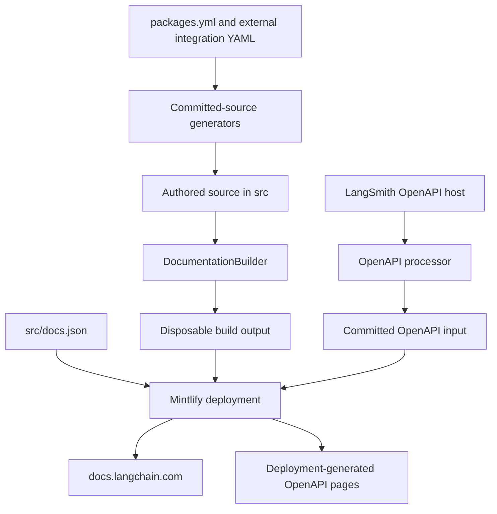

This repository builds the Mintlify site at `docs.langchain.com`. It does **not** build the separately generated `reference.langchain.com` site. The primary maintenance boundary is durable input versus output: `src/` is the authored documentation tree, `src/docs.json` is the Mintlify site contract, and `build/` is disposable deployment output. Never edit `build/`.

The diagram distinguishes authored source, generated-but-committed inputs, Mintlify deployment-generated endpoint pages, and disposable `build/` output.

## Ownership boundaries

| Concern | Durable owner | Safe change boundary |
| --- | --- | --- |
| Page prose, frontmatter, assets, reusable fragments, and executable examples | `src/` | Edit source, not `build/`. |
| Navigation, redirects, site settings, and OpenAPI declarations | `src/docs.json` | Update navigation and redirects explicitly when changing public pages. |
| Route construction and Markdown transformation | `pipeline/` | Change code with focused pipeline tests. |
| Deployment artifact | `build/` | Regenerate; do not patch. |
| Package catalogue | `packages.yml` | Change metadata or its generator, then regenerate committed output. |
| Third-party integration rows | `scripts/data/integration_external_docs.yaml` | Maintain the external record, not a rendered table row. |
| Public LangSmith REST specification | `src/langsmith/langsmith-platform-openapi.json` and its processor | Change processing policy or refresh the committed input, not endpoint MDX. |
| Verification and publication | `tests/`, `Makefile`, and `.github/workflows/` | Change the owner of the invariant rather than a produced artifact. |

## Navigation is not the source tree

`AGENTS.md` and `src/docs.json` are the authority for navigation. The site has two product menus, **AGENT DEVELOPMENT LIFECYCLE** and **PRODUCTS AND SETUP**, each composed of menu items rather than a flat tab list. Lifecycle labels are product language, not directory names: Build draws from both `src/oss/` and `src/langsmith/`; Test, Deploy, and Monitor draw from `src/langsmith/`. Conversely, the `src/langsmith/fleet/` directory appears as **No-code agents**, while `src/oss/deepagents/code/` appears as **Deep Agents Code** in Products and setup. Locate a page by its source directory, then place it in the appropriate product, menu item, tab, and group in `docs.json`.

`src/` is organized by authoring ownership rather than mirroring public URLs. Key roots are `src/langsmith/`, `src/oss/`, `src/snippets/`, `src/images/`, and `src/code-samples/`. Adding an emitted page does not add it to navigation: `docs.json` independently owns navigation, redirects, and OpenAPI configuration. Preserve a redirect when a public URL moves.

`DocumentationBuilder.build_all()` deletes and recreates `build/`, produces Python and JavaScript OSS variants, builds Deep Agents Code and OpenWiki once at unversioned OSS routes, builds LangSmith content, and copies shared files including `docs.json`. Shared OSS content can be emitted for one language only when only that language's navigation lists the route; otherwise it is emitted for both. The Build menu lists the unversioned OpenWiki routes in both language dropdowns. Managed Deep Agents is a separate exception: matching `src/langsmith/managed-deep-agents*.mdx` files emit Python and JavaScript variants, and unversioned URLs redirect to the Python variant.

## Build and authoring mechanics

The builder preprocesses MD and MDX before writing it. It resolves `@[...]` cross-references, adds UTM parameters to LangSmith CTA links, selects the active `:::python` or `:::js` content, and preserves unsupported conditional labels. Scoped entries in `pipeline/preprocessors/link_map.py` are the authority for links: unresolved symbols are logged and left literal rather than guessed.

Snippets are shared source but language-aware at build time: Markdown snippets receive default, Python, and JavaScript copies, and imports from language-targeted pages are rewritten to the matching copy. JSX and TSX snippet components remain shared. This avoids broken relative links for snippet consumers at different route depths.

Source traversal is containment-safe. The builder skips source-tree symlinks and files whose resolved path leaves the collection root, so a committed link cannot import host data into the output. Preserve this invariant when changing traversal or adding a collection.

The `docs` console script is the pipeline entry point. `docs dev` normally builds first, watches `src/`, and serves `build/` through `mint dev`; an initial build failure stops server startup. `--skip-build` instead uses the existing build directory. Use the `Makefile` targets as normal wrappers.

## API reference boundaries

Do not conflate three reference surfaces:

- `reference.langchain.com` is generated and deployed outside this repository.
- Mintlify reads `docs.json` declarations for Agent Server, Control Plane, and LangSmith REST. It generates their endpoint pages during deployment, not in authored MDX or local `build/` output.
- `src/langsmith/langsmith-platform-openapi.json` is a generated-but-committed input. Its processor fetches only an allow-listed LangSmith host (or reads local input), hides fleet, internal, and health operations, groups and orders tags, and normalizes visible operation titles before writing the file.

The daily OpenAPI workflow runs that processor, makes no commit when the specification is unchanged, and appends changes to the standing `chore/refresh-langsmith-openapi` PR. Change the upstream contract or processing policy; do not hand-edit deployment-generated endpoint pages.

## Runnable samples and committed generated source

`src/code-samples/` owns runnable documentation examples. `make test-code-samples` executes them. `make code-snippets` extracts marked regions into the ignored `src/code-samples-generated/` intermediate and renders committed display MDX under `src/snippets/code-samples/`. Edit and test the program, then regenerate; do not patch either derived layer.

Snippet markers determine their display MDX. The extractor recognizes `:snippet-start:` / `:snippet-end:`, removes nested `:remove-start:` / `:remove-end:` regions, and fails on an unclosed removal region. The MDX generator formats supported language intermediates and derives the MDX filename from the snippet id. For example, `rag-deep.py` owns the `rag-deep-index-py` display fragment.

The agent-registration guide demonstrates the boundary: `create-an-agent.mdx` imports `create-agent-py.mdx`, derived from a marked region in `src/code-samples/langsmith/create-an-agent.py`. The source directs the real SDK to a loopback fixture and asserts creation and retrieval requests, so it verifies the contract without creating a live agent.

The LangSmith agent pages are separately authored responsibilities rather than generated API reference: `agents.mdx` defines the workspace-agent-environment-trace model, `agent-environments.mdx` defines the fixed environment set, `create-an-agent.mdx` defines registration, and `log-traces-to-agent.mdx` defines trace addressing. In particular, trace addressing requires identifier and environment together; explicit code addressing wins over environment variables, partial environment configuration warns and leaves calls untraced, and agent addressing cannot be combined with legacy project destinations.

## Packages and integrations

`packages.yml` is package metadata for generated integration surfaces. The partner-package generator writes the Python provider overview, and CI regenerates it to reject manual drift. The weekly package-download workflow updates metadata, regenerates the provider overview and download or featured snippets, and creates a PR only when tracked output changed.

Integration download tables combine hosted integration-page frontmatter with third-party rows from `scripts/data/integration_external_docs.yaml`. A third-party name links to its validated `docs_url`, not a hosted guide. CI validates accepted URL schemes. Use the metadata source that owns the row instead of editing a rendered table.

The Monday integration-repository workflow runs the liveness checker with `--write` and creates or appends changes only to the standing `chore/dead-integration-repos` draft PR. For a dead third-party GitHub home, the checker may adopt a live third-party replacement evidenced by PyPI, npm, or external documentation. It retains live GitLab, partner-documentation, and first-party alternatives for attention; only when no live alternate exists does it delist the package and remove associated listing surfaces.

## CI and publication

The main CI workflow calls reusable test, lint, and link-validation workflows, separately checks merge-conflict markers, cross-references, external-document URL schemes, and generated files, and cancels an older run for the same workflow and ref. The reusable link workflow validates built links with anchors and validates the Agent Server OpenAPI specification.

Publication is separate: a `main` push runs `make build`, verifies `build/`, nests it under `public/build`, and publishes it to the `prod` branch. This requires output to remain reproducible and disposable.

## Change guide

1. **Add or move a page:** edit the relevant `src/` MDX, update its `docs.json` location within the correct product menu, and add a redirect for a retained public URL.
2. **Change routes, language rendering, snippets, or links:** modify `pipeline/`, preserve containment safety, add focused tests, and rebuild.
3. **Change a runnable example:** edit and test `src/code-samples/`, run `make code-snippets`, and commit its rendered snippet MDX rather than the ignored intermediate.
4. **Change provider or integration listings:** choose `packages.yml`, hosted-page frontmatter, or `integration_external_docs.yaml` according to ownership, then regenerate.
5. **Change Mintlify API reference:** change `docs.json`, the committed specification, or `process_langsmith_openapi.py`; never author endpoint MDX.
6. **Change CI or scheduled maintenance:** update the workflow, script, and relevant tests together; preserve standing-PR behavior where the workflow implements it.

## Related pages

- [Build system](/openwiki/architecture/build-system.md)
- [Reference docs](/openwiki/integrations/reference-docs.md)
- [Adding pages](/openwiki/operations/adding-pages.md)
- [Quickstart](/openwiki/quickstart.md)
- [Code sample lifecycle](/openwiki/workflows/code-sample-lifecycle.md)
- [LangSmith OpenAPI refresh](/openwiki/workflows/langsmith-openapi-refresh.md)
