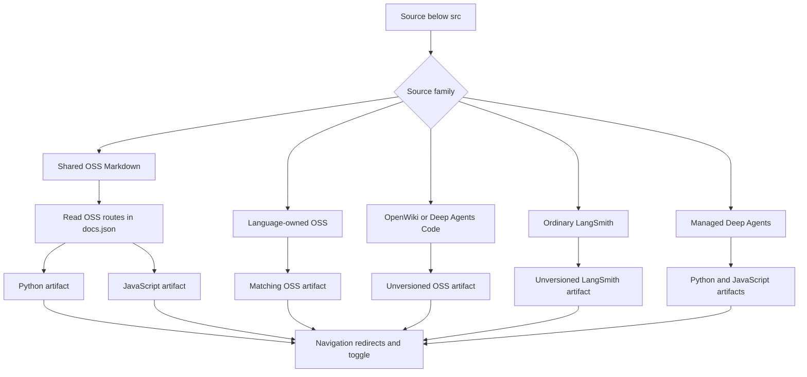
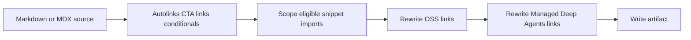

# Documentation Routes and Language Versioning

A documentation URL is the result of four separate contracts. Keep them separate when adding, moving, or retiring content:

1. **Source ownership** is the source path family under `src/`; it determines the builder pass and the eligible route family.
2. **Build artifact** is the file emitted beneath disposable `build/`.
3. **Navigation membership** is the reader-facing projection in `src/docs.json`. For shared OSS Markdown, it also selects whether the page is emitted for one language or both.
4. **Redirects and the language toggle** preserve or navigate public URLs; neither creates an artifact.

`docs.json` is copied as a shared build input. It does not reclassify an OpenWiki, LangSmith, or language-owned source, but it is an intentional input to **shared OSS Markdown** selection. Do not infer source ownership from a product menu: the Build menus mix `src/oss/` and `src/langsmith/` sources.

## Route-family model

This diagram separates ownership and emitted output from the reader-facing contracts. `docs.json` is a routing input only at the shared-OSS decision; its navigation and redirect data do not create source files.

| Authored source family | Clean full-build output | Rendering target |
| --- | --- | --- |
| Shared Markdown/MDX below `src/oss/`, outside special roots | Python, JavaScript, or both according to language navigation | `python` and/or `js` |
| `src/oss/python/...` | `/oss/python/...`, with `python/` removed from the remainder | `python` |
| `src/oss/javascript/...` | `/oss/javascript/...`, with `javascript/` removed from the remainder | `js` |
| `src/oss/deepagents/code/...` | `/oss/deepagents/code/...` | `python` fallback |
| `src/oss/openwiki/...` | `/oss/openwiki/...` | `python` fallback |
| Ordinary `src/langsmith/...` | `/langsmith/...` | `python` fallback |
| Direct `src/langsmith/managed-deep-agents*.mdx` | `/langsmith/python/...` and `/langsmith/javascript/...` | `python` and `js` |

### Navigation-aware shared OSS selection

For a shared OSS Markdown page, the builder recursively reads `oss/python/...` and `oss/javascript/...` routes from `docs.json`, caching the result until the config modification time changes. A route listed in exactly one language navigation emits only for that language. A route listed in both—or in neither—emits for both. This prevents a one-language page that uses conditional fences from producing an empty or misleading unlisted sibling.

A directory landing page has one additional rule: a navigation entry such as `langchain/rag` can stand for `langchain/rag/index`, but not when `src/oss/<language>/langchain/rag.mdx` owns that public route. Non-Markdown OSS files are not subject to this navigation test and are emitted in both language passes. If `docs.json` is absent or invalid, the safe fallback is both variants.

Language-owned directories remain ownership boundaries, not navigation controls. The full OSS pass skips the other ownership tree and strips the matched language component before writing the artifact.

## Full builds establish published route shape

`build_all()` deletes and recreates `build/`, then builds OSS Python and JavaScript output, unversioned Deep Agents Code, unversioned OpenWiki, ordinary LangSmith, Managed Deep Agents variants, shared files, and npm snippets. Use a **clean full build** to establish published route shape and to remove artifacts left by an earlier ownership decision.

Do not use a single-file build as the authority for every route question. It does apply the current navigation-aware shared-OSS rule, so it is useful during development. But it cannot remove obsolete siblings already in `build/`, does not reconstruct all shared inputs or npm overlays, and `build/` may contain state from an earlier route family. After moving a page, changing ownership, navigation, or redirects, validate the required routes and the absence of prohibited siblings with a clean full build.

The source collector rejects symlinks and regular paths that resolve outside the requested root. This prevents a source-tree link from causing host content to appear in generated artifacts.

## Content selection and output transformations

Shared content can contain complete `:::python` and `:::js` units. Matching supported blocks contribute their content without markers; closed blocks for the other target are removed. Escaped `\:::` becomes literal `:::`. Unsupported labels and unclosed blocks remain unchanged, while an invalid target raises `ValueError`.

The conditional processor is a whole-document regular-expression transformation, not a Markdown code-fence-aware parser. Do not nest conditionals or place literal live markers in a code fence expecting them to be ignored; escape markers that must be displayed.

For a language-targeted Markdown artifact, the ordering is:

This is the transformation order for a language-targeted Markdown artifact.

Preprocessing resolves autolinks, adds UTM parameters to eligible LangSmith CTA links, then evaluates conditionals. The builder maps the internal target `js` to the `javascript` URL component and writes a `.md` input as `.mdx`.

A bare eligible `/oss/...` Markdown destination or quoted `href` gains `/oss/python/` or `/oss/javascript/`. Existing language-qualified routes and image paths are preserved. The unversioned `/oss/deepagents/code` and `/oss/openwiki` route families are also preserved, so an OpenWiki or Code page rendered with the Python fallback can link to ordinary OSS Python documentation without turning its own product links into nonexistent language variants. Bare Managed Deep Agents destinations are rewritten to the active `/langsmith/python/` or `/langsmith/javascript/` route; already-qualified destinations stay pinned.

Markdown snippets are shared inputs but are generated as Python and JavaScript copies with target-specific preprocessing and absolute rewritten links. The original snippet path is a Python-targeted default for unversioned importers. A versioned Markdown import is rewritten to `/snippets/python/...` or `/snippets/javascript/...`; an existing scoped import and JSX or TSX component imports remain shared.

## Unversioned and LangSmith exceptions

OpenWiki and Deep Agents Code each build once at their unprefixed OSS paths. Their Python rendering target selects `:::python` conditional content; it does **not** create a Python route. Ordinary LangSmith content likewise builds once below `/langsmith/` with the Python target.

Managed Deep Agents is the LangSmith exception. A direct top-level `managed-deep-agents*` `.md` or `.mdx` file is recognized by targeted building and produces both language artifacts, while the ordinary LangSmith pass excludes it. The full build discovers only direct `.mdx` files matching `managed-deep-agents*.mdx`; use that shape for a published page. `docs.json` supplies unversioned-to-Python compatibility redirects because no unversioned Managed Deep Agents artifact is emitted.

## Navigation, redirects, and the browser toggle

`docs.json` projects Managed Deep Agents into parallel Python and TypeScript tabs, including the same Get started, Agent capabilities, and Build and deploy group structure. It projects OpenWiki's same unprefixed `/oss/openwiki/...` routes into both Build language dropdowns, while Deep Agents Code is separately listed as a product-menu item. These menu placements are reader-facing projections, not alternate source ownership.

Compatibility redirects are another independent public-URL contract. In particular, former Python and JavaScript Deep Agents Code roots and wildcard descendants redirect to the unprefixed Code family. Redirects preserve incoming URLs; they neither emit a page nor make the language toggle valid for that family.

The language-toggle script recognizes only paired `/oss/python/` ↔ `/oss/javascript/` and `/langsmith/python/` ↔ `/langsmith/javascript/` prefixes. It preserves the fragment identifier, uses a short-lived `sessionStorage` record to survive a full reload, and consumes a pending switch once. An unprefixed page has no computed counterpart. The script explicitly hides the language dropdown for `/oss/openwiki` and descendants even though OpenWiki appears in both Build dropdowns.

## Safe change procedure

1. Choose the source family first; do not select a directory from a menu label.
2. For shared OSS Markdown, update both intended language navigation projections—or intentionally list it in only one to select one emitted variant. For language-owned and unversioned sources, navigation does not change source ownership.
3. Update redirects for retired public URLs independently of navigation and output generation.
4. Run a clean full build. Inspect required artifacts and the absence of obsolete language siblings without editing `build/`.
5. Inspect selected conditional content, snippet import paths, OSS links, and Managed Deep Agents links in every applicable artifact.
6. Run `make broken-links-with-anchors`; after changing `@[...]` references, also run `make check-cross-refs`.
7. Add focused builder tests when changing classification, navigation-aware selection, link rewriting, or source-collection safety. Test browser behavior separately for both prefix pairs, hash preservation, pending-switch expiry, and unversioned exceptions.

## See also

- [Documentation build system](/openwiki/architecture/build-system.md)
- [Preprocessing](/openwiki/concepts/preprocessing.md)
- [Adding pages](/openwiki/operations/adding-pages.md)
- [Builder tests](/openwiki/testing/builder-tests.md)
- [Changing versioned content](/openwiki/workflows/versioned-content.md)
