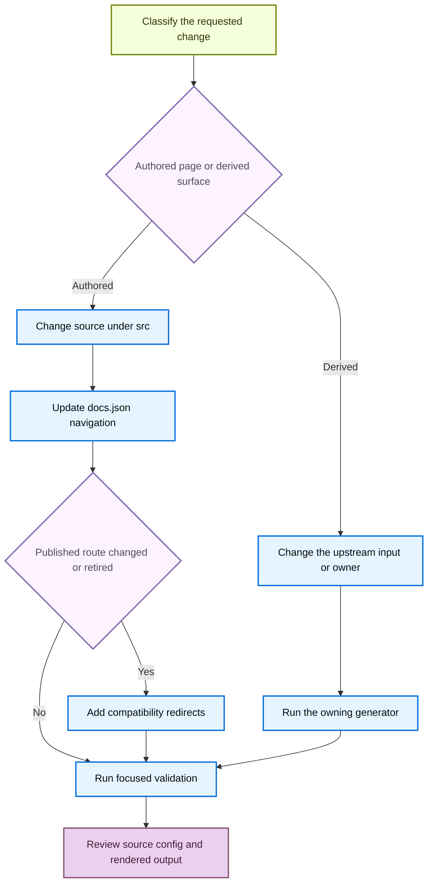

# Adding, Moving, and Retiring Documentation Pages

A page change is complete only when its authored input, emitted public route, `src/docs.json` navigation, redirects, and rendered output agree. Manual content belongs under `src/`; do not edit `build/`, because a full build clears and recreates it. For generated material, change the upstream input or use its owning generator rather than editing output.



This lifecycle makes route compatibility an explicit decision instead of an accidental side effect of moving a file.

## Establish ownership and route family

Use `add-docs-page` for a page lifecycle change. For a change requested on an existing PR, use the PR's head branch and verify facts against the owning implementation or configuration, not a sibling documentation page.

Choose a source directory by the page's subject and source ownership, then find its reader-facing location in the actual navigation. Directory names alone do not determine navigation placement: `src/langsmith/fleet/` appears as **No-code agents**, while the Build menu includes both OSS and LangSmith material.

| Source family | Authored location | Emitted public routes | Required navigation decision |
| --- | --- | --- | --- |
| Shared OSS | `src/oss/`, outside language-owned directories | Usually `/oss/python/...` and `/oss/javascript/...` | Add routes to the relevant language branches. A shared page listed in exactly one language branch builds only for that language; a page listed in both or neither builds for both. |
| Language-owned OSS | `src/oss/python/` or `src/oss/javascript/` | Matching language route | Add the route in the matching language branch. |
| OpenWiki and Deep Agents Code | `src/oss/openwiki/` or `src/oss/deepagents/code/` | One unversioned `/oss/openwiki/...` or `/oss/deepagents/code/...` route | Add the single route in the product location that serves the reader journey. |
| Ordinary LangSmith | `src/langsmith/` | One `/langsmith/...` route | Place it in the appropriate lifecycle or product menu. |
| Managed Deep Agents | Direct `src/langsmith/managed-deep-agents*.mdx` files | `/langsmith/python/...` and `/langsmith/javascript/...` | Add the matching routes in both Managed Deep Agents language tabs. |

Shared OSS uses one source file, not two copies. Use supported `:::python` and `:::js` fences for target-specific material. Preprocessing keeps only the active supported-language block, resolves `@[ref]` references, and the builder rewrites ordinary unprefixed `/oss/...` links to the target language route.

OpenWiki and Deep Agents Code are language-agnostic exceptions. They build once and resolve conditional blocks against the Python branch. From versioned OSS content, link to these pages with `/oss/openwiki/...` or `/oss/deepagents/code/...`, without a language segment; the builder deliberately excludes those roots from OSS link rewriting.

Managed Deep Agents is the opposite exception. Direct matching source files do not emit ordinary unversioned LangSmith pages: the builder emits Python and JavaScript variants. A bare `/langsmith/managed-deep-agents...` link in language-targeted content follows the target language. Existing unversioned URLs redirect to Python, so do not add a duplicate unversioned source page.

## Add an authored page

`src/docs.json` is the authoritative navigation, route, and redirect configuration. The current hierarchy is `navigation.products[]` → `menu[]`; a menu item can contain direct `pages`, `tabs`, or, for Build, `dropdowns[]` containing `tabs[]`. A `pages` array can mix route strings and nested `{ "group": ..., "pages": [...] }` objects. Find a neighboring route in its actual branch rather than inferring placement from a directory or menu name.

1. Inspect a nearby page, then create the `.md` or `.mdx` file under the selected source owner. Every MDX page needs `title` and a plain-text `description`; do not use Markdown, links, or backticks in the description.
2. Use supported code-block language tags and supported language conditionals. Test every code example before publishing it.
3. Add the extensionless path relative to `src` to the appropriate `pages` array. For example, `src/langsmith/sandboxes.mdx` becomes `langsmith/sandboxes`.
4. Add every route that the selected family emits. This normally means two routes for shared OSS and Managed Deep Agents, one for language-owned or unversioned content, subject to the shared-OSS navigation rule above.
5. Put an index route first in a new group. For a page in an existing integration component, update the component's `index.mdx`; update `docs.json` only when creating a component group.
6. Before changing a heading, search inbound fragment links. A heading slug is public. Capitalization-only changes retain the lowercased slug; otherwise update inbound links or retain a landing target with an explicit component `id`.

A route can intentionally appear through more than one discovery path. For example, `bind-evaluator-to-dataset-link.mdx` is a navigation wrapper whose `url` targets the canonical `bind-evaluator-to-dataset` route. Keep a wrapper and its canonical target coherent rather than deleting one solely because their titles overlap.

### Use the removed-pages checker as a limited guard

`scripts/check_removed_pages_redirects.py` compares navigation with a base revision, verifies source-file candidates for the page shapes it extracts, and accepts exact or covering `:path*` redirects for deleted routes. It traverses direct product pages, legacy tabs, dropdown tabs, and groups, but it does not enter the current `navigation.products[].menu[]` layer. It therefore cannot prove source existence or redirect coverage for menu-contained routes.

Use it as an additional guard, not proof that a current menu change is correct. Inspect the relevant menu branch, build clean output, and run Mint link checks after changing a route, navigation entry, or redirect:

```bash
python3 scripts/check_removed_pages_redirects.py --base-ref origin/main src/docs.json
```

## Move or retire a published page

Preview a source-file move with the repository mover:

```bash
uv run docs mv src/langsmith/evaluation.mdx src/langsmith/deploy/evaluation.mdx --dry-run
```

The installed `docs` console script dispatches to `pipeline.cli:main`. The mover scans source Markdown, MDX, and notebook Markdown cells; rewrites matching relative and site-absolute links; and updates matching `docs.json` navigation values and redirect destinations. It intentionally leaves redirect sources unchanged, because those old URLs must remain redirect sources. When a directory changes, it recalculates relative links within the moved document. Review any `Left ... links unchanged` warning: the mover leaves route forms it cannot safely map unchanged.

Dry-run makes no changes. A real move records the move in `link_changes.jsonl`, relocates the source, and updates internal links. It does not choose navigation placement or create compatibility redirects.

After a move, rename, or retirement:

1. Correct or remove the route in the actual `docs.json` menu branch.
2. Search root-relative and fragment references to the old public route or heading, including mover warnings.
3. Make an explicit redirect decision for every published old route. Add a compatibility redirect whenever that route moved or was removed, including every applicable language route.

```json
{ "source": "/langsmith/evaluation", "destination": "/langsmith/deploy/evaluation" }
```

Redirects are top-level `redirects` entries and use site paths. For Managed Deep Agents, retain or replace legacy unversioned aliases to a Python route, and add redirects for changed Python and JavaScript routes.

## Change generator inputs, not generated assets

`build/` is validation output. The builder clears it before rebuilding from `src`, and `make dev` performs an initial build, watches `src`, then runs `mint dev` from `build`. Never hand-edit it.

Workflow-owned outputs also require changes to their upstream source or owner, not manual output edits. These include the weekly LangSmith and Fleet changelogs, the self-hosted changelog, the LangSmith platform specification, and the Agent Server specification.

### Reusable blocks and runnable examples

Reusable MDX blocks belong in `src/snippets/` and use imports of the form `from '/snippets/...'`. The builder rewrites that form to language-specific snippet paths; Mintlify's `<Snippet file="..." />` form does not receive that rewrite. Extract a block that appears on three or more pages.

Runnable examples belong in `src/code-samples/`. `make code-snippets` extracts derivative files under `src/code-samples-generated/` and `src/snippets/code-samples/`. Edit and test the runnable source, then regenerate derivatives rather than hand-editing them.

```bash
make test-code-samples FILES="src/code-samples/path/to/sample.py"
make code-snippets
```

The extractor recognizes language-specific `:snippet-start:` and `:snippet-end:` markers, strips presentation-only `:remove-start:` regions, and fails for unclosed snippet or removal regions.

### Generated listings and OpenAPI reference

Integration component tables are generated from hosted integration-guide `integration:` frontmatter and external discovery records. External records use `docs_url`, and the refresh script rejects unsafe URL schemes before it renders a row.

`docs.json` `openapi` groups configure Mintlify endpoint generation. Agent Server and LangSmith REST have committed specifications and explicit directories; Control Plane is fetched from a remote URL at deployment. Generated endpoint pages are not present in local build output. Do not add authored endpoint MDX pages to replace them.

The LangSmith OpenAPI processor accepts default remote input only from allow-listed `api.smith.langchain.com`, filters and normalizes operations, organizes sidebar tag groups, and writes only when invoked with `--write`.

```bash
uv run python scripts/process_langsmith_openapi.py --write
make check-openapi
```

`make check-openapi` builds first and currently runs `mint openapi-check` only on `build/langsmith/agent-server-openapi.json`.

## Validate the emitted contract

Choose checks based on the changed surface. For an added, moved, renamed, or retired authored page, run the focused prose lint, a clean build, and the anchor-aware link check:

```bash
make lint_prose FILES="src/path/to/page.mdx"
make build
make broken-links-with-anchors
```

Add focused checks as appropriate:

1. Run `make check-cross-refs` after modifying `@[...]` references.
2. Run the relevant sample, generator, integration refresh, or OpenAPI command after changing its input.
3. Use `make dev` to inspect rendered output. Inspect both language outputs for shared OSS and Managed Deep Agents changes.
4. Use `make broken-links` for route or non-fragment link changes. It builds, asks Mint to check redirects and links, filters expected reports from deployment-time OpenAPI pages and standalone snippets, and fails on remaining reports. Use `make broken-links-with-anchors` when anchors changed; it also checks redirects.
5. When changing mover, builder, or checker behavior, run its focused suite, for example `make test TEST_FILE=tests/unit_tests/tools/test_move_files.py`, `make test TEST_FILE=tests/unit_tests/test_builder.py`, or `make test TEST_FILE=tests/unit_tests/test_check_removed_pages_redirects.py`.
6. Run `docs-review` after finished prose changes. Skip it for a redirect-only or navigation-only change.
7. Review authored source, `src/docs.json`, generator inputs, regenerated artifacts, and emitted routes. A `build/` diff is evidence, not durable source.

## Completion checklist

- [ ] The change is in authored source or a generator input, never `build/` or deployment-generated output.
- [ ] The page has required frontmatter, a plain-text description, supported syntax, and the required `src/docs.json` update.
- [ ] Navigation lists every emitted route in the correct current `menu` branch; placement was chosen from the reader journey, not the directory name alone.
- [ ] Every moved or removed public route has an explicit redirect decision, with compatibility redirects where needed.
- [ ] Snippets, samples, listings, changelogs, and specifications were regenerated or changed through their owners.
- [ ] Focused validation, a clean build, appropriate link checks, and applicable prose review ran.
- [ ] Source configuration and rendered output were reviewed, including manual review of menu navigation.

## See also

- [Source directory map](/openwiki/architecture/source-map.md)
- [Versioning](/openwiki/concepts/versioning.md)
- [Mintlify integration](/openwiki/integrations/mintlify.md)
- [CLI tools](/openwiki/operations/cli-tools.md)
- [Documentation quickstart](/openwiki/quickstart.md)
- [Testing overview](/openwiki/testing/test-overview.md)
