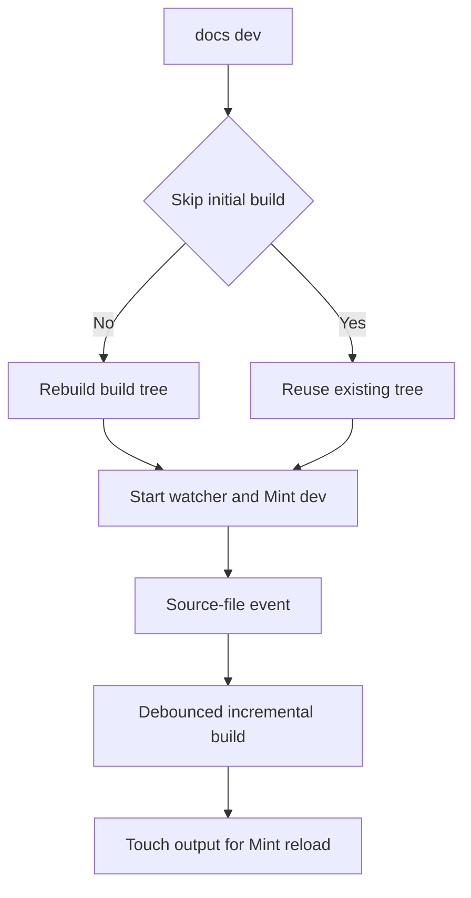
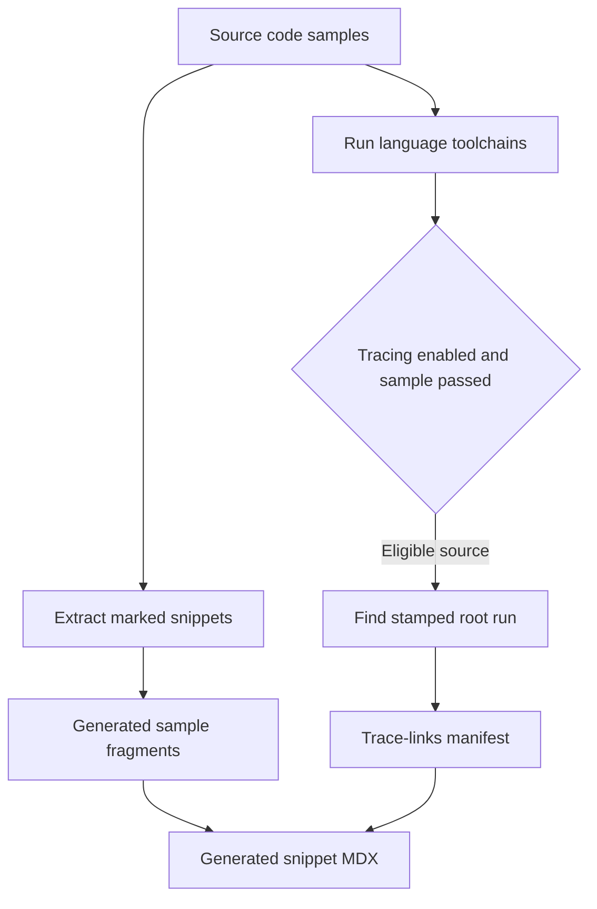

# Developer Commands and CLI Tools

Author documentation in `src/`, not `build/`. A full build deletes and recreates `build/`, the disposable Mintlify input, so manual edits there are lost. Run commands from the repository root unless a target changes directories. For Mintlify validation, use the Make targets: they rebuild as appropriate and run Mint from `build/`, avoiding root-level parsing of unrelated checkout files such as a virtual environment.

## Install and choose the command layer

`.mise.toml` defines the local baseline: Node 22, Python 3.13, uv 0.9.26, Vale 3.17.1, prek, and the Mint CLI. Start with `mise trust && mise install` when using mise; its postinstall hook installs prek pre-commit and pre-push hooks. The project requires Python `>=3.13.0,<4.0.0` and uv `>=0.9.26`; Node 22 is intentional because Mintlify does not support Node 25 or newer.

```bash
make install
```

`make install` synchronizes all uv dependency groups, installs root Node dependencies, installs `mint@latest` globally with retries, and links repository skills into `.claude/skills/`. Re-run `make skills` after adding or renaming skills; it leaves non-symlink personal entries intact and removes stale skill symlinks.

Two CLIs have separate output boundaries:

- The repository Python CLI transforms source and runs the source-to-build pipeline. It is registered as `docs = "pipeline.cli:main"`; use `uv run pipeline <command>` in a checkout or `docs <command>` after installation.
- The separately installed `mint` executable serves, checks, and exports the generated site. Make invokes its built-site operations from `build/`.

| Need | Preferred command | Boundary |
| --- | --- | --- |
| Install dependencies and skills | `make install` | repository tooling |
| Rebuild documentation | `make build` | `src/` to `build/` |
| Preview an edit | `make dev` | builder, watcher, and Mint server |
| Check `@[ref]` references | `make check-cross-refs` | source reference map |
| Reject retired hosts | `make check-legacy-links` | authored Markdown and MDX under `src/` |
| Check rendered links and fragments | `make broken-links-with-anchors` | regenerated `build/` tree |
| Run a focused pipeline test | `make test TEST_FILE=unit_tests/test_watcher.py` | selected pytest path |
| Exercise an example | `make test-code-samples FILES="src/code-samples/..."` | selected executable sample |

See [Build System](/openwiki/architecture/build-system.md), [Adding Pages](/openwiki/operations/adding-pages.md), [Local Development](/openwiki/workflows/local-development.md), [Test Overview](/openwiki/testing/test-overview.md), and [Code Sample Lifecycle](/openwiki/workflows/code-sample-lifecycle.md) for adjacent workflows.

## Build, watch, and preview

### `make build` and `docs build`

`make build` first runs `npm install`, then invokes `uv run pipeline build` with the repository on `PYTHONPATH`. `docs build` verifies that `src/` exists, creates `build/` if needed, then delegates to `DocumentationBuilder`; it returns 0 on success and 1 when the source directory is absent. `DocumentationBuilder.build_all()` removes and recreates the build directory, emits versioned and unversioned documentation, copies shared files, and copies npm snippet components. Treat `build/` as generated output.

Although the argument parser accepts `docs build --watch`, `build_command()` does not read that argument: it builds once. Use `docs dev` for watching.

### `make dev` and `docs dev`

`make dev` runs `npm install` and starts `uv run pipeline dev`. Unless `--skip-build` is supplied, `docs dev` first performs the full build. It then watches `src/` recursively and starts `mint dev --port 3000` from `build/`, forwarding Mint output. `--skip-build` reuses the existing tree and only warns if it is missing.



*Development flow: the pipeline owns generated output; Mint serves that output.*

The watcher ignores editor temporary files, batches changes for 0.2 seconds, and rebuilds supported changed files; deletions remove the corresponding generated file. An initial-build failure, missing Mint, a nonzero Mint exit, or an unexpectedly stopped watcher fails development. Ctrl+C shuts down the watcher and terminates Mint, killing it after five seconds if needed. Use a full build after broad structural changes rather than relying on incremental output.

## Source migration and safe moves

These commands operate on source paths, not generated output. Prefer `--dry-run` before an operation that writes.

- `docs migrate <path>` recursively selects notebooks, Markdown, and `.markdown` files; `docs migrate-docusaurus <path>` also selects MDX. Both accept `--output <path>` or update in place. `--dry-run` prints instead of writing, and a parse failure is recorded per file so the batch continues. In-place notebook conversion writes `.md` and deletes the original notebook only after success.
- `docs mv <old_path> <new_path>` discovers the Git root, scans `<root>/src` Markdown, MDX, and notebook content, and rewrites relative cross-references to the moved file. It preserves anchors and recalculates relative links inside the moved Markdown, MDX, or notebook file. `--dry-run` previews all changes without writes or a move.
- The move tool additionally rewrites safe site-absolute routes in documentation and `src/docs.json` navigation entries and redirect destinations, but leaves redirect sources unchanged. It warns and leaves ambiguous versioned forms or forms without an equivalent destination unchanged. Review its diff and run `make broken-links-with-anchors` afterward; prose mentions are outside its safe rewrite scope.

```bash
uv run pipeline migrate legacy/guide.md --dry-run
uv run pipeline migrate-docusaurus legacy/ --output converted/
uv run pipeline mv src/langsmith/old.mdx src/langsmith/new.mdx --dry-run
```

## Generated-site checks and exports

`build` is phony. `make broken-links`, `make broken-links-with-anchors`, `make check-openapi`, and `make export` declare it as a prerequisite, so each starts from a fresh generated tree. `make htmltest` deliberately has no build prerequisite: it validates an existing export archive.

| Target | Operation and prerequisites |
| --- | --- |
| `make broken-links` | From `build/`, runs `mint broken-links --check-redirects`, filters known non-actionable output, and fails only if an indented link report remains. |
| `make broken-links-with-anchors` | Adds `--check-anchors`; use after heading, fragment, route, redirect, navigation, or ordinary-link changes. |
| `make check-openapi` | From `build/`, runs `mint openapi-check langsmith/agent-server-openapi.json`. |
| `make export` | Verifies `mint export`, rejects Node 25+, then exports from `build/`. It requires Node 20 or 22, a recent Mint CLI, and an Enterprise Mintlify plan. Pass `MINT_EXPORT_ARGS` for Mint arguments. |
| `make htmltest` | Requires `htmltest`, `unzip`, and `EXPORT_ZIP` (default `build/export.zip`); it unpacks to `HTMLTEST_UNPACK_DIR` and checks external URLs using the supplied configuration. |
| `make export-htmltest` | Runs export and then htmltest sequentially. |

The broken-link filter drops complete standalone snippet sections, deployment-only OpenAPI and legacy-path reports, and, only in the anchor variant, specified SmithDB migration anchor false positives. Standalone snippet links are excluded because they resolve only after import into a page. Remaining reported link entries fail the target. This filtering and working-directory boundary are why raw Mint checks from the repository root are unsupported.

`make check-legacy-links` is a separate source-policy check. It scans authored `.md` and `.mdx` below `src/` by default, or paths supplied as arguments, rejects configured retired documentation hosts, permits the Helm repository exception, and reports relative documentation routes or `https://reference.langchain.com/` as replacement destinations.

## Format, lint, and test the repository

- `make lint` runs Ruff format and lint checks, `ty`, and `codespell src`. `make format` applies Ruff formatting and fixes; `make format-check` is non-mutating.
- `make test` runs pytest with network sockets disabled except Unix sockets. Set `TEST_FILE` to narrow it, for example `make test TEST_FILE=unit_tests/tools/test_move_files.py`.
- `make lint_md` requires `markdownlint`; `make lint_md_fix` applies its fixes.
- `make lint_prose [FILES="src/path/page.mdx"]` installs or reuses the pinned Vale executable, then checks the supplied paths or `src/`, excluding `node_modules` and `src/code-samples`.

Vale derives its version from `.mise.toml`. The installer accepts only a semantic version, reuses a matching `vale` on `PATH` or installs it at `.bin/vale`, and falls back to `go install` if the release download fails. `.vale.ini` maps MDX to Markdown, skips frontmatter and fenced code, runs LangChain, proselint, Vale, and write-good rules at error severity, disables Vale spelling, and limits the provider-catalog exception to its configured file.

## Executable samples, generated snippets, and trace cards

`src/code-samples/` is executable source. `src/code-samples-generated/` is an extraction intermediate; `src/snippets/code-samples/` is generated MDX. Do not hand-edit either generated directory.



*Snippet generation and execution are independent; tracing is a best-effort post-success path that can add MDX cards.*

### Generate snippets

`make code-snippets` extracts marked regions from supported Python, TypeScript, Java, Kotlin, Go, and shell sources under `src/code-samples/` to `src/code-samples-generated/`, then generates importable MDX under `src/snippets/code-samples/`. Extraction removes `:remove:` regions and fails on unclosed markers. A full extraction removes prior supported intermediate files. Set `CODE_SNIPPET_SOURCES` to existing, supported paths beneath `src/code-samples/` for a partial extraction; it replaces only outputs for the selected source stems and rejects missing, out-of-tree, or unsupported selections.

The generator appends a `View example trace` card only for a manifest entry. It can expand eligible generic Python or TypeScript agent model values into configured Deep Agents provider tabs. `KEEP MODEL`, provider-specific calls, and embedding model IDs prevent a value from being selected for tab expansion.

### Run samples

`make test-code-samples` installs dependencies from the separate `src/code-samples/package.json` before running all eligible `.py`, `.ts`, `.java`, `.kt`, `.go`, and `.sh` files, or a space-separated `FILES` selection. TypeScript uses that package and its committed lockfile version 3 via `npx tsx` from `src/code-samples/`; Python uses the root uv project, Go resolves the shared `src/code-samples/go.mod`, shell uses `bash`, and Java/Kotlin use JBang with Java 21. The runner preserves the caller environment for credentials and live services.

The root project declares `langsmith>=0.14.12`, and the committed lock resolves version 0.14.12; this is the Python sample dependency floor. For example, `src/code-samples/langsmith/create-an-agent.py` uses a loopback HTTP fixture and isolated environment to exercise two marked snippets without creating live agents, then asserts the observed request sequence:

```bash
make test-code-samples FILES="src/code-samples/langsmith/create-an-agent.py"
```

The runner defaults to four workers; `CODE_SAMPLE_JOBS` overrides the limit, while configured groups sharing a LangSmith dataset or experiment fixture are serialized. Its default timeout is 1,200 seconds. Normal nonzero exits, missing toolchains, and timeouts fail. Detected LangSmith rate limits retry up to five times by default with configurable backoff capped at 120 seconds; a sample still rate-limited after retries is skipped rather than failed.

### Refresh trace links

`make update-code-sample-traces` installs the TypeScript sample dependencies, sets `CODE_SAMPLE_TRACING=1`, defaults `LANGSMITH_PROJECT` to `docs-code-samples`, runs selected samples, and regenerates snippet MDX. Publishing trace links requires `LANGSMITH_API_KEY`.

Only successful samples collect traces. For an eligible single-snippet source, the runner stamps `LANGSMITH_DOCS_SNIPPET`; collection is lock-serialized, records claimed run IDs to prevent parallel reuse, and polls for a matching stamped root run in the sample window before sharing it. A source with no marker or an unsafe ID gets no trace link. Multi-snippet sources are recorded as skipped and stale single-snippet entries are removed. If no matching run is found for a successful single-snippet sample, any prior manifest entry is removed rather than retained. Trace lookup, sharing, and collection failures warn without failing the sample suite.

## Remote audits and focused completion

`python3 scripts/check_llms_urls.py [--base-url URL]` validates the deployed site rather than `build/`: it crawls the root `llms.txt` and nested indexes, compares their reachable pages with the served sitemap, and exits 1 after reporting sitemap pages absent from the index.

`uv run python scripts/check_onboarding_models.py` reports rather than edits stale configured onboarding-snippet model IDs. It reads GitHub by default, using `GITHUB_TOKEN` or `GH_TOKEN` if available, or reads a checkout with `--repo-dir`; it exits 0 when current, 1 for stale IDs, and 2 if its registry or inputs cannot be read.

For a focused change, run only the matching checks: selected `make test` for pipeline code, `make check-cross-refs` for `@[ref]` edits, `make check-legacy-links` for authored external links, `make lint_prose FILES="..."` for prose, targeted sample execution for an example, and `make broken-links-with-anchors` for rendered navigation or links. Use `make export-htmltest` only when exported-site external-link coverage is needed.

Core CI uses Python 3.13. Its reusable test and link jobs run `make test` and the built-site link/OpenAPI targets respectively. The code-sample workflow runs all samples on scheduled or manual events, changed eligible samples on pull requests, and regenerates snippets only after a scheduled or manual traced run updates trace links. Running the same targets locally exercises CI's command boundaries rather than approximating them with raw tools.
