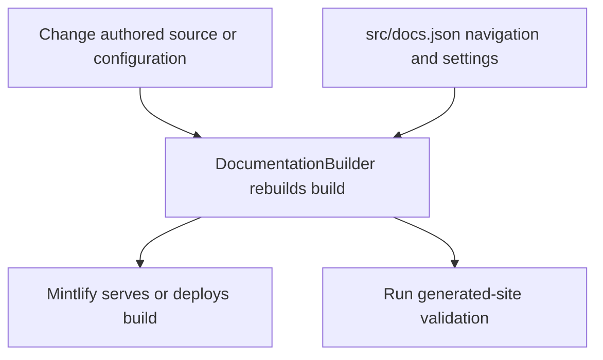

# Repository Guide and Change Routing

This repository builds the Mintlify documentation site at [docs.langchain.com](https://docs.langchain.com). The safe starting point is the durable input: authored documentation lives in `src/`, while `build/` is disposable generated deployment output. Do not edit `build/`; a full build removes it and recreates it. The separate SDK reference site at `reference.langchain.com` is generated outside this repository.



*Authoring and configuration feed a regenerated Mintlify tree; validation should inspect that tree rather than hand-patched output.*

## Start a local preview

The project requires Python 3.13 or later. From a checkout, install dependencies and start the development loop:

```bash
make install
make dev
```

`make install` synchronizes all Python dependency groups, installs project npm dependencies and the global Mintlify CLI, and links authoring skills. `make dev` performs an initial build, watches `src/`, and starts `mint dev --port 3000` from `build/`; open <http://localhost:3000>. It does not start the server after an initial build failure. Use `uv run pipeline dev --skip-build` only when an existing generated tree is known to be current.

The installed `docs` console script dispatches to `pipeline.cli:main`; it provides `dev`, `build`, `mv`, `migrate`, and `migrate-docusaurus`. Make targets are the usual contributor entrypoints.

## Choose the owner before changing files

`AGENTS.md` is the repository-wide authoring contract. It requires manually authored work in `src/`, plain-text frontmatter descriptions, Tabler icons, tested examples, and a `src/docs.json` update for a new page. Task-specific procedures live in `.agents/skills/`; `make skills` links them into `.claude/skills/` for Claude Code. Changes to scripts, workflows, Make targets, checks, scheduled jobs, or skills also require the `docs-tooling-notion` follow-up before PR handoff.

| Change request | Durable owner and safe action | Read next |
| --- | --- | --- |
| Add, move, retire, or revise a page, asset, navigation item, or redirect | Select the applicable `src/` owner; update `src/docs.json` and redirects for public-route changes | [Adding, Moving, and Retiring Documentation Pages](/openwiki/operations/adding-pages.md) |
| Understand source ownership, route families, or generated surfaces | `src/`, `src/docs.json`, generators, and pipeline routing—not rendered output | [Repository Source Map](/openwiki/architecture/source-map.md), [Documentation Build System](/openwiki/architecture/build-system.md) |
| Change language variants, route behavior, conditional content, or scoped links | The selected `src/oss/` family plus `src/docs.json`; test both applicable language scopes | [Documentation Routes and Language Versioning](/openwiki/concepts/versioning.md), [Markdown Preprocessing](/openwiki/concepts/preprocessing.md) |
| Change a runnable tutorial or displayed extracted code | Edit and execute `src/code-samples/`, then regenerate derived snippets | [Runnable Code Samples and Snippet Generation](/openwiki/workflows/code-sample-lifecycle.md) |
| Change provider listings or external integration discovery | Use hosted-guide `integration:` frontmatter, `scripts/data/integration_external_docs.yaml`, `packages.yml`, or the owning generator | [Repository Source Map](/openwiki/architecture/source-map.md) |
| Change build, watcher, preprocessing, CLI, or route-generation behavior | Change `pipeline/` with focused tests; inspect a clean build | [Documentation Build System](/openwiki/architecture/build-system.md), [Builder and Route Tests](/openwiki/testing/builder-tests.md) |
| Change CI, a scheduled job, preview automation, or repository tooling | Change `.github/workflows/` and the invoked script or command together | [Testing and Validation Overview](/openwiki/testing/test-overview.md) |
| Change Mintlify configuration or deployment-time OpenAPI references | Use `src/docs.json` and the declared specification or upstream process; do not author endpoint MDX | [Mintlify Integration](/openwiki/integrations/mintlify.md), [Reference Documentation Boundaries](/openwiki/integrations/reference-docs.md) |
| Report an SDK API-reference issue | Use the reference-documentation issue template; do not look for an SDK-reference generator here | [Reference Documentation Boundaries](/openwiki/integrations/reference-docs.md) |

## Navigation and route ownership

`src/docs.json` is the Mintlify configuration and navigation source of truth. It does not replace source ownership: choose the source family first, then place its route in the actual navigation branch and preserve or add redirects for changed public URLs.

Menu labels are not reliable directory names. The **Build** menu mixes `src/oss/` and `src/langsmith/` material; `src/langsmith/fleet/` appears as **No-code agents**; and `src/oss/deepagents/code/` appears as **Deep Agents Code** under Products and setup. The two top-level navigation products are **AGENT DEVELOPMENT LIFECYCLE** and **PRODUCTS AND SETUP**.

Most OSS content emits Python and JavaScript routes. OpenWiki and Deep Agents Code are unversioned exceptions; ordinary LangSmith content is unversioned, while Managed Deep Agents emits language variants. A clean build rebuilds these route families and shared files from source, so output is useful for inspection and validation but never the authoring surface.

Mintlify also creates Agent Server, Control Plane, and LangSmith REST endpoint pages at deployment time from OpenAPI declarations. Those endpoint pages are not authored MDX and do not appear in local `build/` output. This differs from `reference.langchain.com`, which is a separate, externally built SDK-reference site.

## Generated and derived content

When a visible file is derived, modify its upstream owner rather than its rendered result:

| Surface | Change instead | Follow-through |
| --- | --- | --- |
| `build/` | Authored `src/`, `src/docs.json`, or pipeline code | Rebuild; a clean build discards output edits. |
| `src/oss/python/integrations/providers/overview.mdx` | `packages.yml` or `pipeline/tools/partner_pkg_table.py` | Run `uv run python pipeline/tools/partner_pkg_table.py`; CI rejects drift. |
| `src/code-samples-generated/` | A marked executable file in `src/code-samples/` | Test source, then run `make code-snippets`. |
| `src/snippets/code-samples/` | The marked executable source | Regenerate and commit the derived MDX rather than hand-editing it. |
| Deployment-generated OpenAPI endpoint pages | `src/docs.json`, the committed specification, or its refresh process | Check the specification or hosted preview as appropriate. |

`make test-code-samples` executes runnable sample source. `make code-snippets` extracts marked regions into `src/code-samples-generated/` and renders imported MDX under `src/snippets/code-samples/`; generation is not sample execution. For shared OSS prose, unfenced `@[ref]` references must resolve in both Python and JavaScript scopes. Put language-specific API names in `:::python` or `:::js` blocks and run `make check-cross-refs`.

## Validate the changed boundary

Use the smallest check that establishes the changed contract, then add a generated-site check for routes, navigation, redirects, anchors, or imports.

| Changed boundary | Focused check |
| --- | --- |
| Pipeline, generator, watcher, or CLI behavior | `make test TEST_FILE=tests/unit_tests/path_or_test.py` |
| Python quality, formatting, types, or spelling | `make lint` |
| Authored prose | `make lint_prose FILES="src/path/to/page.mdx"` |
| Shared or conditional `@[ref]` source | `make check-cross-refs` |
| Route, navigation, redirect, link, or anchor | `make broken-links-with-anchors` |
| Agent Server OpenAPI input | `make check-openapi` |
| Runnable sample or snippet markers | `make test-code-samples FILES="src/code-samples/..."`, then `make code-snippets` |
| Integration discovery URL | `uv run python scripts/refresh_integration_downloads.py --check-docs-urls` |
| Provider overview input or generator | `uv run python pipeline/tools/partner_pkg_table.py` and review the diff |

`make test` runs pytest against `tests/unit_tests` with Internet sockets disabled except Unix sockets. Core CI runs for pull requests, pushes to `main`, and manual dispatch; it invokes test, lint, and built-document checks, plus separate merge-conflict, cross-reference, integration-URL, and provider-overview-drift checks. `make broken-links-with-anchors` builds first, then validates links, anchors, and redirect destinations; CI also runs `make check-openapi`.

## Continue by domain

- [Repository Source Map](/openwiki/architecture/source-map.md): ownership boundaries and generated surfaces.
- [Documentation Build System](/openwiki/architecture/build-system.md): build ordering, preprocessing, watcher limits, and output invariants.
- [Adding, Moving, and Retiring Documentation Pages](/openwiki/operations/adding-pages.md): page lifecycle, navigation, redirects, and focused verification.
- [Testing and Validation Overview](/openwiki/testing/test-overview.md): validation scope and failure triage.
- [Local Documentation Development](/openwiki/workflows/local-development.md): setup, preview behavior, and local command details.
- [Changing Versioned and Unversioned Content](/openwiki/workflows/versioned-content.md): route-family selection and language-aware changes.
