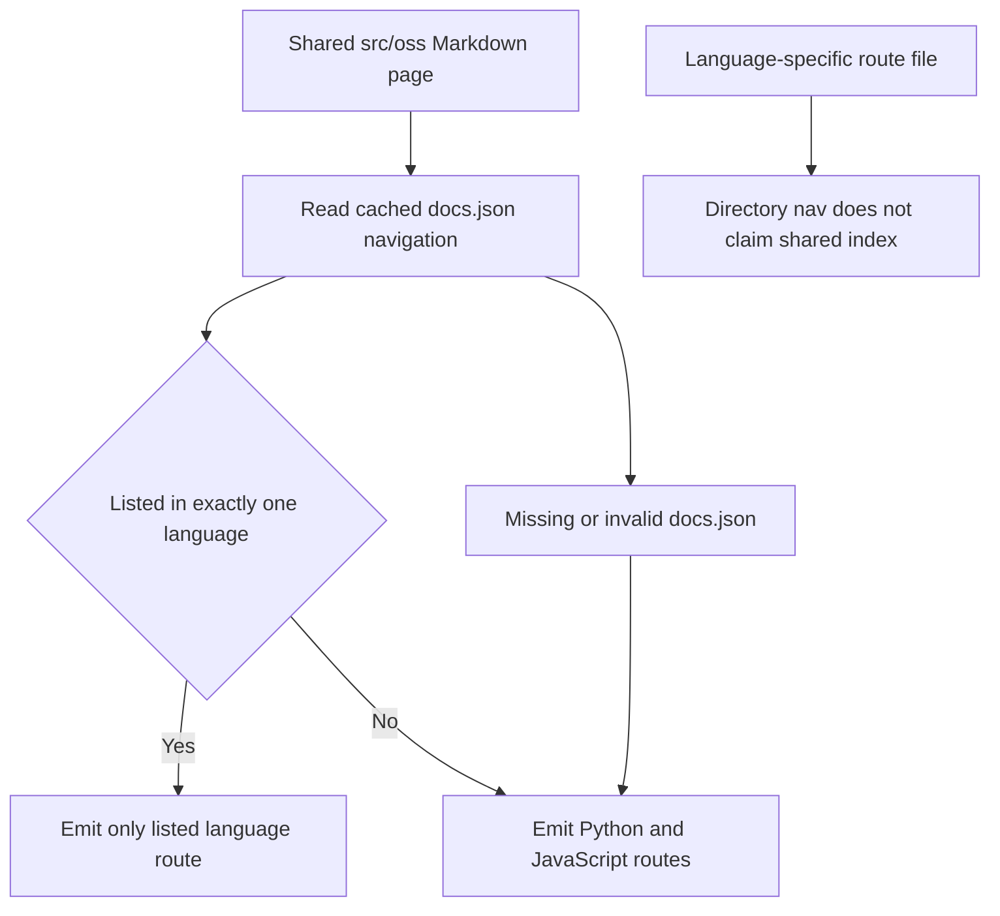

## Scope and test boundary

`DocumentationBuilder` turns authored `src/` inputs into disposable `build/` artifacts. Builder tests should assert observable results: eligible and forbidden routes, transformed Markdown, copied bytes, and propagated failures. A fixture at this boundary proves local routing and transformation behavior; it does **not** prove that Mintlify accepts the complete graph, redirects work after deployment, or the watcher receives real filesystem events.

Run the focused suite while changing this boundary:

```bash
make test TEST_FILE=tests/unit_tests/test_builder.py
```

<!-- openwiki: broken internal link [#validation-ladder] heading anchor "validation-ladder" does not exist in /openwiki/testing/builder-tests.md. Fix the href or restore the target, then delete this comment. -->
`make test` runs pytest with Internet sockets disabled, except for Unix sockets. For changes to output links, anchors, redirects, or snippet imports, follow focused tests with the generated-tree check described in [Validation ladder](#validation-ladder).

For the lifecycle, see [Build System](/openwiki/architecture/build-system.md). For route ownership, see [Language Variants and Route Ownership](/openwiki/concepts/versioning.md). For conditional syntax assertions, see [Conditional Rendering Tests](/openwiki/testing/conditional-rendering.md), and for repository-wide validation choices, see [Testing Overview](/openwiki/testing/test-overview.md).

## Fixture discipline

Use `File` and `file_system()` from `tests/unit_tests/utils.py`. The context manager creates an isolated temporary directory containing `src/` and `build/`, writes each fixture as UTF-8 `content` or binary `bytes`, exposes `list_build_files()` and `build_file_exists()`, and removes the tree on exit. Read an output artifact for a transformation contract; use binary data for a copy contract.

The core pattern is positive **and** negative assertions: test artifacts that must exist, sibling routes that must not exist, and each language artifact's final content.

```python
with file_system([
    File(path="oss/guide.mdx", content=":::python\nPython\n:::\n:::js\nJS\n:::\n"),
]) as fs:
    builder = DocumentationBuilder(fs.src_dir, fs.build_dir)
    builder.build_file(fs.src_dir / "oss/guide.mdx")

    assert fs.build_file_exists("oss/python/guide.mdx")
    assert fs.build_file_exists("oss/javascript/guide.mdx")
```

That example has no `docs.json`, so the shared page is eligible for both languages. Add navigation data when the behavior under test is language-specific eligibility.

## Route eligibility is navigation-aware

For shared Markdown under `src/oss/`, route multiplicity is not simply “always both.” `docs.json` navigation is recursively scanned for `oss/python/...` and `oss/javascript/...` routes and cached by the configuration file's nanosecond modification time. A Markdown page listed in exactly one language navigation is emitted only for that language. A page listed in both—or in neither, including fallback/error pages—is emitted for both. If `docs.json` is absent or invalid JSON, the conservative fallback is both languages.

A navigation entry for a directory may stand for its `index` page, but it does **not** do so when `src/oss/<language>/<directory>.mdx` or `.md` owns that route. This prevents a shared `directory/index` page from colliding with a language-specific page.



This diagram shows how navigation determines the language outputs for a shared OSS Markdown page.

Test the four cases together: Python-only, JavaScript-only, both, and neither. Also keep a focused `build_file()` test: incremental single-file routing applies the same navigation rule as a full build. These tests are the regression boundary for Python-only content accidentally appearing as blank or incorrect TypeScript content.

## Full build and incremental build are different test subjects

`build_all()` clears and recreates `build/`, then runs language-specific OSS collection, unversioned product builds, LangSmith and Managed Deep Agents builds, shared-file copying, and finally the npm component overlay. Use it when asserting discovery, cleanup, ordering, source-language ownership, shared files, or the overlay.

`build_file(path)` is the precise incremental routing entry point and raises `AssertionError` for a missing file. `build_files(paths)` sends one item to `build_file`; for multiple paths it uses the progress-oriented path, disabled in CI. Do not infer full-build discovery behavior from either incremental entry point:

- Full OSS collection recognizes source files below `oss/python/` and `oss/javascript/`, includes each only in its matching language pass, and removes that source-language path segment in the destination.
- Full Managed Deep Agents discovery only globs `langsmith/managed-deep-agents*.mdx`. By contrast, an existing direct `.md` or `.mdx` `build_file()` call is classified as Managed Deep Agents and emits variants. Use `.mdx` when testing full-build discovery.
- Full builds are the recovery path for stale derived artifacts because they delete the entire output tree before reconstruction.

## Route-family coverage

The remaining route families should have small, purpose-built fixtures:

- **Ordinary OSS:** eligible shared pages emit `oss/python/...` and/or `oss/javascript/...` according to navigation; non-Markdown eligible assets receive both target passes. Each Markdown output receives its target language for conditional blocks and rewriting.
- **Unversioned OSS products:** `oss/deepagents/code/` and `oss/openwiki/` build once at their source-relative paths. Their conditional processing uses Python; links within either unversioned product stay unprefixed, while bare links to ordinary OSS become Python routes.
- **Managed Deep Agents:** direct `langsmith/managed-deep-agents*.md` and `.mdx` sources emit only `langsmith/python/...` and `langsmith/javascript/...`. There is no unversioned built page; redirects configured in `docs.json` own those public unversioned URLs.
- **Shared inputs:** `docs.json`; selected root pages; any path containing `snippets`, `images`, `.well-known`, or `fonts`; and `.js` or `.css` files build at their source-relative paths. Markdown snippets are special: they also receive language-specific copies.

Assert forbidden routes explicitly: no language copies for unversioned products, no unversioned Managed Deep Agents page, and no other-language output for a navigation-exclusive shared page.

## Copying and transformation tests

The copy set includes `.mdx`, `.md`, `.json`, image and media formats, YAML, `.css`, `.js`, `.jsx`, `.tsx`, text, font, and HTML files. `TEMPLATE.mdx` and unsupported extensions are skipped. `docs.yml` is special: it is parsed with `yaml.safe_load` and written as indented `docs.json`; parsing and I/O failures are logged and re-raised. Give that behavior a direct failure fixture, not only a successful-output assertion.

For `.md` and `.mdx`, the builder reads source, invokes `preprocess_markdown()`, rewrites imports and links, appends the output-only contribution footer when eligible, and writes `.md` as `.mdx`. Processing errors are logged and re-raised. The footer is omitted for root `index.mdx` and all snippet paths; a footer-construction failure preserves the original content.

Content assertions that matter:

- `_rewrite_oss_links()` prefixes bare absolute `/oss/` Markdown or HTML links with `python` or `javascript`, but preserves existing prefixes, image paths, and Deep Agents Code/OpenWiki paths.
- `_rewrite_managed_deep_agents_links()` prefixes bare Managed Deep Agents links with the current target language while leaving an already prefixed URL intact.
- `_rewrite_snippet_imports_for_language()` redirects Markdown snippet imports to `/snippets/python/...` or `/snippets/javascript/...`; imports that are already scoped, and non-Markdown component imports, remain unchanged.
- `preprocess_markdown()` resolves autolinks, adds UTM parameters to eligible LangSmith CTA links, and keeps only the target conditional branch. Without an explicit target, it reads `TARGET_LANGUAGE` and defaults to `python`.

## Shared snippets and the component overlay

A Markdown snippet has three rendered forms: a default source-relative path with Python-prefixed absolute OSS links for unversioned importers, plus `snippets/python/...` and `snippets/javascript/...` copies. Versioned pages importing an unscoped Markdown snippet are rewritten to their matching copy. Test a nested consumer as well as helper output: absolute links avoid resolution errors at arbitrary page depths.

The full build copies source shared files before applying the `@langchain/docs-sandbox` overlay. The overlay overwrites same-destination source components so `PatternEmbed.jsx` and `ExampleEmbed.jsx` go to `build/snippets/`, while `ChatLangChainEmbed.js` goes to the build root. A missing package or expected mapped file logs a warning rather than failing the build. This precedence is a full-build contract.

## Safety and watcher boundaries

Source collection is a security boundary. `_safe_source_files()` rejects every symlink, including one targeting an ordinary file, and rejects files resolving outside the requested root. A regression fixture should create an external secret and a symlink beneath an eligible directory, then prove the linked artifact and its contents are absent from `build/`.

The watcher is related but not equivalent to a full reconstruction. `DocsFileHandler` ignores names ending in `~`, `.bak`, or `.orig`, and hidden temporary names ending in `.tmp`, `.temp`, or `.swp`. `FileWatcher` de-duplicates pending paths, resets a 0.2-second debounce after each event, rebuilds one file or a batch with at most four worker threads, then touches routed output files for hot reload.

Deletion removes only the source-relative output. Touch routing treats `langsmith` as unversioned, so generated Managed Deep Agents variants are not reliably removed or touched incrementally. Test watcher logic with controlled queues and mocked build/touch work rather than timing or a real observer, and use a clean `build_all()` to recover from stale derived output.

## Command and validation ladder

At the command boundary, `build_command()` returns `1` when its source directory is absent. Otherwise it creates the build directory, invokes `DocumentationBuilder.build_all()`, and returns `0`. Keep command exit tests separate from routing tests.

After focused builder tests, run the generated-site check when a change affects output links, redirects, anchors, navigation, snippet imports, or the rendered graph:

```bash
make broken-links-with-anchors
```

The target depends on a fresh build, runs Mint from `build/`, checks anchors and redirects, filters known standalone-snippet reports, and fails for remaining broken-link records. It validates the generated tree rather than deployed rendering.

1. Start with the smallest isolated fixture for the changed contract.
2. Assert required and forbidden artifacts, then inspect final content for each relevant output language.
3. Use `build_all()` for discovery, cleanup, ownership, ordering, shared files, and overlay behavior; use `build_file()` to prove incremental routing.
4. Add `make broken-links-with-anchors` after an output-graph or renderer-facing change.
