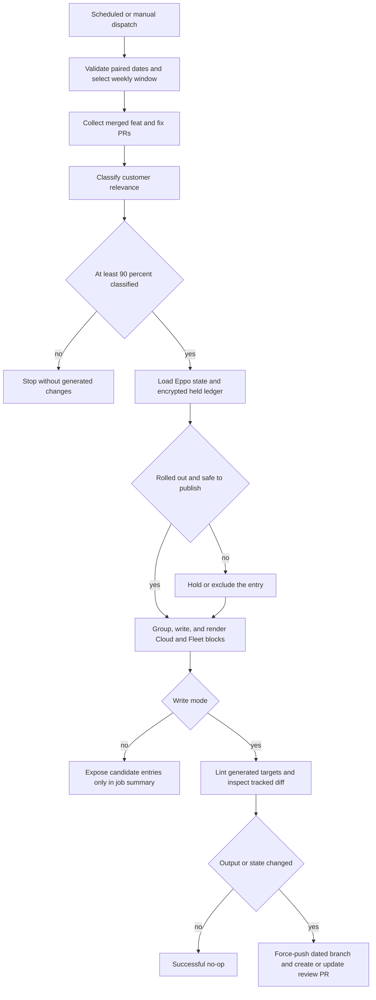

# Weekly LangSmith Changelog Publication

The Cloud and Fleet changelogs are pipeline-owned publication outputs, not an authoring shortcut for private upstream work. The weekly process collects merged PRs from `langchain-ai/langchainplus`, proposes customer-facing entries for `src/langsmith/changelog.mdx` and `src/snippets/langsmith/fleet-changelog.mdx`, and opens a review PR; it does not merge or deploy that PR. The Fleet changelog page imports the generated snippet, while the Cloud page is the direct target. Both are RSS-enabled customer surfaces.

Treat upstream PR text, model responses, Eppo flag state, credentials, local run artifacts, and `scripts/.changelog_held.json.enc` as security-sensitive. The safe output boundary is deliberately narrow: only rendered candidate entries can appear in a dry-run job summary, and normal PR text contains aggregate counts and lint output rather than the detailed run report. Do not use manually edited generated targets or a held ledger to force publication; correct the pipeline inputs or rollout state, rerun, then review the resulting diff.

## Entry point, schedule, and decision flow

`.github/workflows/changelog-weekly.yml` runs at 13:00 UTC every Monday and also supports manual dispatch with optional paired `since` and `until` dates. Its normal path invokes `scripts/changelog_pipeline.py weekly --out "$RUNNER_TEMP/changelog" --write`; a dry run leaves off `--write`. The command chooses the Monday-to-Monday period ending on the latest Monday when no dates are supplied. The end date is exclusive, so a PR merged on that Monday belongs only to the next weekly window.



*The weekly pipeline fails closed at classification and rollout decisions, then separates generated candidates from the write-mode review proposal.*

A local investigation can produce cached artifacts without mutating repository targets; `--write` is the mutation boundary:

```bash
uv run python scripts/changelog_pipeline.py weekly --out /tmp/changelog
uv run python scripts/changelog_pipeline.py weekly --out /tmp/changelog --since 2026-10-05 --until 2026-10-12 --write
```

In write mode, the command first exits successfully if either target already contains the calculated week label. Otherwise it writes the recalculated encrypted held ledger and inserts each non-empty product block before the first existing `<Update>` block. A missing update marker is an error rather than an implicit placement decision.

## Collection, caching, and model boundary

Collection pages through closed upstream PRs and retains merged titles matching `feat` or `fix` in the half-open date range. Cherry-picks and backports are removed before model processing. Each cached PR record under `--out/prs` has a bounded body and a budgeted diff; fragments, lockfiles, snapshots, and minified files are omitted from the diff, source files are preferred ahead of tests, and omitted paths are recorded. Cached PR records and later results let reruns resume completed work rather than repeat calls.

If `ANTHROPIC_API_KEY` is configured, the weekly command performs a small model preflight before collection. An invalid gateway key or configuration therefore stops once rather than failing independently for each PR. Classification is concurrent and error-tolerant per PR, but the weekly orchestration refuses to continue when fewer than 90% of collected records have classification results; a partial changelog is not an acceptable fallback.

Haiku assigns `announce`, `minor`, or `internal` based on concrete customer-visible evidence in the diff. For announce-tier work, Sonnet groups related PRs into ranked `highlight`, `change`, `fix`, or `drop` groups; a retry groups PRs omitted by the first response, while invented PR numbers and dropped groups do not proceed. Sonnet writes highlights and Haiku writes other entries. The renderer creates independent Cloud and Fleet `<Update>` blocks, including ranked highlights and sections, and limits each product's accordion of fixes to 20 entries.

PR titles, bodies, file paths, diffs, and model results must not be trusted as instructions or as publication-ready text. Prompts explicitly direct the models to ignore instructions embedded in PR content. API calls request closed JSON schemas; the fallback `claude` CLI has no tools, no setting sources, no session persistence, and an empty temporary working directory. Refusals, truncated turns, malformed JSON, and item-level model errors do not become entries.

## Customer-safe rendering and conservative gates

Before rendering, product-name replacements are applied and MDX-sensitive `<`, `{`, and `}` characters are escaped outside code spans. The safety pass checks generated titles and entries for internal services or paths, ticket-style IDs, implementation component names, hosting internals, and known flag keys. A detected leak goes through a Haiku rewrite and is checked again; a failed, still-leaking, or intentionally dropped rewrite is excluded. Wording that claims a limited rollout is excluded rather than rewritten to imply general availability.

The pipeline also holds a group when the classifier identified a real Eppo flag that is not fully rolled out, or when the group overlaps a held PR in both code area and title topic. Unknown gating evidence is excluded. These controls are intentionally conservative: missing model coverage, malformed grouping, uncertain rollout state, or unsafe customer wording reduces output rather than expanding it.

## Held-state lifecycle and Eppo rollout gate

`scripts/.changelog_held.json.enc` persists a mapping from PR number to flag and release metadata for work that must wait. It is encrypted Fernet state in a public repository. `CHANGELOG_STATE_KEY` is required to decrypt or write it; an absent, invalid, or wrong key stops the operation, and an `.enc` path is never written as plaintext. A legacy plaintext sibling can be read for migration, but it is folded into sorted encrypted state and deleted only after an encrypted write succeeds.

For announce-tier PRs, a standalone `Flag: <key>` description declaration overrides an older `.changelog` fragment declaration; `Flag: none` means no declared gate. The parser ignores declarations in comments, quoted or indented text, and fenced code. Conflicting declarations, missing Eppo flags, and flags archived before verified rollout are removed from held state without publishing; pending flags remain held. Once a flag qualifies, a previously held PR is recollected and classified for the current proposal. If it cannot be recollected, it remains held for a later run.

A flag is fully rolled out only when an active production environment has a catch-all allocation with full exposure serving exactly one variation. For Boolean flags, that variation must be `true`. Targeted-only, partial, split, inactive, archived-allocation, or false-serving configurations never authorize release. Eppo credentials are read from `EPPO_API_KEY` (or the explicit key-file option for the separate `flags` command), are not logged or cached, and requests use the hard-coded HTTPS Eppo host.

The `flags` subcommand is an evaluation and attribution extension rather than part of `weekly`: it snapshots Eppo rollout state, searches a local upstream checkout at both window endpoints for nearby flag references, asks Haiku to choose only among discovered candidates, and writes a report under `--out`. It supports analysis of flag attribution without weakening the publication gate.

## Workflow operations and review boundary

The Actions job has a 90-minute timeout and serializes `changelog-weekly` runs without cancelling the active one. It receives a read-only upstream GitHub token, Anthropic gateway configuration, Eppo access, and the held-state key through secrets. A GitHub App token is used for checkout, branch writes, and PR operations so resulting pull-request workflows can run. Keep all secret values, upstream PR details, model payloads, and decrypted state out of logs, fixtures, commands, and public review text.

Before a non-dry run, the workflow tests that its date-based `changelog/weekly-<UTC-date>` branch can be pushed. If that branch already contains any commit whose author email is not `github-actions[bot]`, the job skips rather than force-overwriting human changes. Otherwise it runs Vale on the two generated changelog targets with `continue-on-error: true`. Vale is review information, not a publication approval gate.

The workflow considers only the Cloud target, Fleet snippet, and held-state paths when deciding whether to create a PR. No generated text and no state diff is a successful no-op. On a change, it force-pushes the dated branch, creates a PR against `main`, or updates the existing same-day PR body. The PR is the human publication gate: reviewers should check the customer-facing wording and links, count summary, encrypted-state diff, and Vale output before merging. For the general workflow trust model, see [GitHub Actions and CI Automation](/openwiki/integrations/github-actions.md).

Dry runs write only `mock.mdx` candidates to the Actions summary. The detailed report remains under `--out` because it can identify private PRs, held work, rejected wording, and internal signals. Normal review PR bodies similarly contain counts and the trailing Vale output, not that report. This distinction is a security boundary, not merely a presentation choice.

## Related commands and validation

`selfhosted` is a distinct CLI path for one Helm-chart release. It accepts a whitespace-separated PR-number file, can reuse prior PR and classification caches, filters eligible `feat` and `fix` PRs, and renders `release.mdx` plus a review file beneath `--out`. It groups operator-relevant changes into upgrade, change, fix, or drop layers and screens generated text for internal names and ticket IDs; it does not insert into a self-hosted changelog.

Run the focused deterministic suite after modifying pipeline behavior:

```bash
make test TEST_FILE=tests/unit_tests/test_changelog_pipeline.py
```

The suite disables Internet sockets and uses mocks or helpers to cover weekly labels and windows, strict structured schemas and API failures, flag declaration parsing, collection filtering, rendering and insertion order, rewrite and rollout exclusions, encrypted-state failure and migration, Eppo rollout semantics, and Eppo host allowlisting. It does not validate live upstream GitHub access, Anthropic or Eppo credentials, Actions branch/PR writes, secrets handling in a hosted runner, or the rendered site. Use the appropriate operational review in addition to the focused tests; see [Developer Commands and CLI Tools](/openwiki/operations/cli-tools.md) and [Testing and Validation Overview](/openwiki/testing/test-overview.md).
