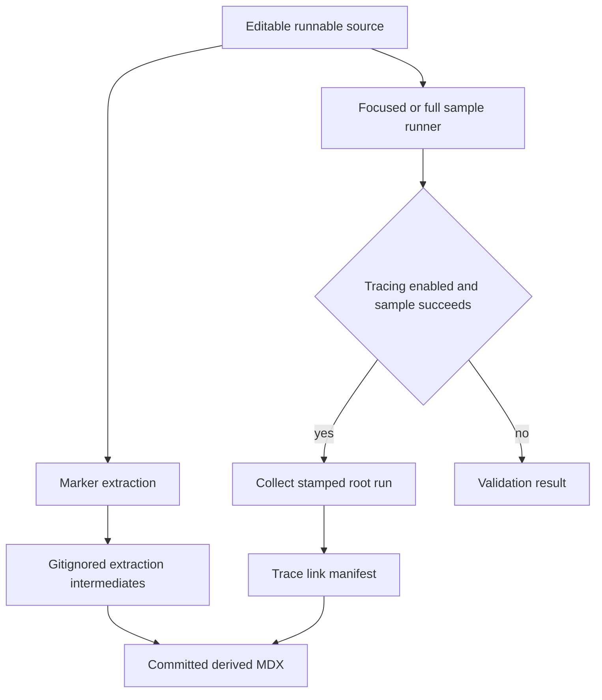
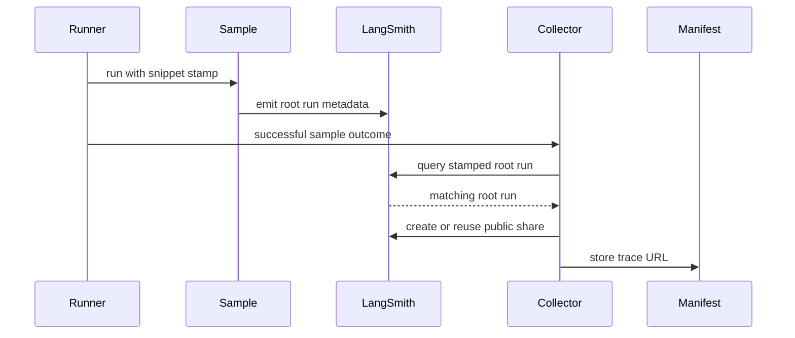

## Source of truth and lifecycle

The editable authoring surface is the supported-language files under `src/code-samples/`. Extraction writes disposable files to `src/code-samples-generated/`, which is gitignored; rendering writes the committed MDX fragments under `src/snippets/code-samples/`. Therefore a documentation change starts in the runnable source, is validated as a program, and is followed by regeneration and review of the derived MDX and any page that imports it. Neither a package manifest nor a generated fragment is unrelated prose: dependencies determine whether the source runs, and committed MDX is its rendered documentation contract.



This diagram separates the three states of a sample artifact and shows that trace publication is an optional post-success input to rendering, not a prerequisite for ordinary validation.

## Author markers and extraction

The extractor supports `.py`, `.ts`, `.java`, `.kt`, `.go`, and `.sh` files below `src/code-samples/`. Delineate reader-visible code with matching `:snippet-start: <id>` and `:snippet-end:` comment lines: `#` for Python and shell, and `//` for TypeScript, Java, Kotlin, and Go. IDs must end in the language suffix `-py`, `-js`, `-java`, `-kt`, `-go`, or `-sh`; extraction can create an intermediate for a mismatched ID, but the renderer deliberately does not emit its MDX.

Extraction is line-based rather than AST-based. It accepts indented markers, removes matched `:remove-start:` / `:remove-end:` regions from the displayed body, dedents and normalizes the result, and fails rather than silently producing partial output when a snippet or remove region is unclosed. Use remove regions for test-only setup, cleanup, and assertions, but ensure the source still reaches and exercises the visible code.

A runnable TypeScript file is one module: all visible regions and remove blocks execute in the same module scope. Keep shared code together when that is intentional, but split independent examples if they would redeclare imports or top-level bindings. The `langgraph-sql-agent.ts` sample illustrates the tradeoff: its visible download, database, tool, graph, and human-in-the-loop regions rely on shared bindings and its hidden harness executes checks against the assembled program. It is a useful multi-fragment documentation source, but it has multiple snippet IDs and is not eligible for one public trace link.

## Test the source and maintain language boundaries

Run a focused source while editing it, or omit `FILES` for the recursive supported-file scan:

```bash
make test-code-samples FILES="src/code-samples/langgraph/langgraph-sql-agent.ts"
make test-code-samples
```

The runner accepts an explicit supported file list or discovers samples, then executes Python with the repository's `uv` environment, TypeScript with `npx tsx`, Java and Kotlin with JBang on Java 21, Go with `go run`, and shell with `bash`. Go and shell run from `src/code-samples/`; Go consequently resolves against the shared `go.mod`. Each process has a default 1,200-second timeout.

TypeScript has a single dependency boundary: `src/code-samples/package.json` owns dependencies for every TypeScript sample and `src/code-samples/package-lock.json` captures the resolved graph. `make test-code-samples` runs `npm install` in that directory before invoking `tsx`, and the runner executes each `.ts` file from the same directory so module resolution uses that installation. Add or update a TypeScript import by changing the shared manifest and lockfile together, then run the affected sample; do not add per-sample manifests or treat the lockfile change as incidental.

The runner uses four workers by default. It serializes the `evaluate-rag-` and `experiment-runs-query-` families because they share LangSmith fixtures, while unrelated samples remain concurrent. Recognized LangSmith rate limits are retried up to five attempts with a linear delay starting at 30 seconds and capped at 120 seconds; both attempt count and base delay are configurable. A sample still rate-limited after those attempts is reported as skipped, whereas other nonzero exits, timeouts, and unavailable toolchains are failures.

## Generate and review derived snippets

```bash
make code-snippets
```

This target extracts before it renders. A full extraction clears supported intermediate files and rebuilds `<source-stem>.snippet.<snippet-id>.<extension>` files, then the renderer scans the intermediate tree and writes `<snippet-id>.mdx` files. `CODE_SNIPPET_SOURCES` is a fast, selective extraction mode: it replaces intermediates only for selected valid source stems, but rendering still considers all intermediates already present. Use a full extraction before relying on the generated tree as a complete refresh.

The renderer produces the language fence, recognizes optional leading code-group tab and fence-modifier markers, and can turn an eligible Python or TypeScript routable model string into a seven-provider `CodeGroup`. It updates the first eligible model ID and subsequent matching occurrences. `KEEP MODEL`, embeddings model IDs, and values supplied to embedding or provider-specific chat constructors are intentionally not expanded, because substituting a routable `provider:model` string there would make the sample invalid. A manifest URL adds a **View example trace** Card only to the corresponding rendered snippet.

Provider strings are language-specific: generated Python variants use `google_genai:`, while TypeScript uses `google:` for `@langchain/google`. Generator tests also prohibit legacy `google_search` in TypeScript sample sources and require both the declared and lockfile-resolved `@langchain/google` version to meet the 0.2.6 floor, protecting Gemini examples that combine built-in and function tools.

Use the focused generator test after changing these rendering rules, provider conventions, or the TypeScript package boundary:

```bash
make test TEST_FILE=tests/unit_tests/test_generate_code_snippet_mdx.py
```

## Optional trace publication

`make update-code-sample-traces` is an explicit publication operation. It requires `LANGSMITH_API_KEY`, enables tracing, uses `LANGSMITH_PROJECT` or the default `docs-code-samples` project, runs the chosen samples, and regenerates MDX. A public share is therefore an intentional consequence of executing a real sample, not a replacement for a deterministic local fixture.



This sequence shows the guarded publication path for a source that contains exactly one safe snippet ID.

With tracing enabled, the runner sets `LANGSMITH_DOCS_SNIPPET` for a sole eligible marker. Collection is serialized under a lock and excludes run IDs already claimed by another worker; it requires that exact metadata on a root run rather than selecting a nearby run. A multi-snippet source is recorded as skipped and any stale per-snippet entries are removed. If a successful eligible source has no stamped root run, an existing entry is also removed, so the next generation removes an unverified CTA. Trace collection happens only after sample success, uses the same 429 retry policy, and warns instead of failing an otherwise successful suite when collection itself errors.

## CI: changed files, full runs, and refresh pull requests

The **Test Code Samples** workflow is triggered by relevant pull requests, manual dispatch, and at 00:00 UTC on the first day of each month. Fork pull requests are skipped because secrets are unavailable. An internal pull request computes the merge-base diff and tests only changed eligible files under `src/code-samples/`; a manual or scheduled invocation tests all samples and enables tracing. The job provides PostgreSQL, Python, Node, Java/JBang, and Go, and allows 60 minutes for a pull request versus 150 minutes for a full run.

The test step continues after an error so a bounded number of ordinary sample failures does not prevent refresh of traces collected from passing samples. On a manual or scheduled run, MDX regeneration requires that the test was not cancelled, fewer than 20 samples failed, and at least one trace link was updated. If that succeeds, CI creates or appends to `chore/refresh-code-sample-traces` only when `src/code-samples/trace-links.json` or the generated snippet tree differs. The final job step nevertheless fails for ordinary sample failures. A separate workflow creates a Linear issue only when a scheduled run fails or is cancelled.

## Safe change checklist

1. Edit the executable source under `src/code-samples/`; use derived MDX only as generated output to review or import.
2. Use unique, language-suffixed, balanced markers. Place hidden setup and assertions in remove regions without bypassing visible code.
3. Run the focused file with `make test-code-samples FILES="…"`; for TypeScript, update the shared `package.json` and `package-lock.json` together when imports change.
4. Run `make code-snippets` and inspect every affected committed fragment and the documentation pages that import it. Use a full extraction for a complete refresh.
5. Run the focused generator test when model expansion, Google conventions, or dependency-version safeguards are relevant.
6. Publish a trace only from a single-snippet source that intentionally emits a real, shareable LangSmith root run.

## Related pages

- [Repository Source Map](/openwiki/architecture/source-map.md)
- [Local Tooling and Commands](/openwiki/operations/cli-tools.md)
- [Testing and Validation Overview](/openwiki/testing/test-overview.md)
- [LangSmith agent documentation](/openwiki/workflows/langsmith-agent-documentation.md)
