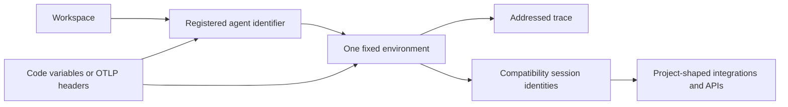

## Scope and ownership

This workflow maintains a connected documentation contract rather than duplicating product pages. The authored LangSmith MDX and reusable snippets describe an agent record, its trace destinations, managed deployments, and integrations from different entrypoints. Change the smallest owner of a rule, then follow that rule to its consumers.

| Surface | Editable owner | Change safely | Do not edit as a source |
| --- | --- | --- | --- |
| Agent, environment, registration, addressing, resolution, and observability narrative | Authored `src/langsmith/*.mdx` | Update the owner page and dependent guides/snippets that restate its contract. | Rendered files under `build/`. |
| Shared setup and integration wording | `src/snippets/langsmith/*.mdx` and `src/snippets/*.mdx` | Update the snippet and inspect every importing guide. | A copied inline version in one consumer. |
| Managed Deep Agents | Authored `managed-deep-agents*.mdx` pages and their imported snippets/sample sources | Keep overview, quickstart, local-development, deployment, and MCP-boundary wording aligned. | A language-prefixed emitted route or redirect as if it were a separate source page. |
| Registration display fragments | Marked regions in `src/code-samples/langsmith/create-an-agent.py` | Change executable code and its fixture assertions, execute it, then regenerate. | `src/code-samples-generated/` or generated MDX as primary input. |
| LangSmith REST reference | Platform contract plus `scripts/process_langsmith_openapi.py` policy | Regenerate the committed input through the dedicated refresh process and review deployment output. | Individual committed JSON operations, endpoint MDX, or build output. |
| Navigation and redirects | `src/docs.json` | Make an explicit navigation and route decision for an add, move, or rename. | An emitted URL as evidence of navigation ownership. |

`src/docs.json` independently places the agent setup pages, observability quickstart, resolver, and REST reference in the product navigation. Managed Deep Agents is additionally a language-versioned Build tab: authored `managed-deep-agents*.mdx` files emit Python and JavaScript routes, while the unversioned routes redirect to Python. A source page, navigation entry, redirect, and emitted route are therefore related but not interchangeable maintenance targets.

## Product-model invariants



This flow distinguishes trace routing by an agent/environment pair from compatibility identities that older project-shaped callers consume.

Preserve these rules wherever the pages introduce, configure, or query tracing:

1. **Address is a pair.** An identifier and environment select the destination together. The code-facing environment values are `local`, `development`, `staging`, and `production`; neither component supplies a default. Explicit SDK configuration wins over environment variables.
2. **Identifier is not display name.** The identifier is immutable; a display name can change. Examples must address traces with the identifier and must not derive it from a UI label or deployment name.
3. **Creation is setup.** Programmatic registration needs a credential with `projects:create`, not a tracing key. It creates the LangSmith record; it does not create the framework agent that runs in an application. A duplicate identifier returns `409`.
4. **Environment storage is a compatibility bridge.** `tracer_session_name` is for integrations that require a project name. `tracer_session_id`, or a resolved `session_id`, is for APIs whose fields are named `project_id`, `project_ids`, or `session_id`. Authors and readers must retrieve these values from the selected environment rather than construct them from an agent name.
5. **Do not mix destination dialects.** Agent addressing cannot coexist with `LANGSMITH_PROJECT`, `LANGCHAIN_PROJECT`, `LANGCHAIN_SESSION`, or the equivalent OTLP project header for the same trace. A partial agent-variable pair warns and leaves otherwise unaddressed calls untraced; an explicit address together with `project_name` is an error.
6. **Capability is a boundary.** Agent addressing is for Cloud agent-based workspaces. Project-based and self-hosted documentation uses project configuration; self-hosted ingestion rejects agent-addressed runs.

## Change connected documentation by responsibility

### Agent, environment, and query pages

- `agents.mdx` owns the workspace → agent → environment → trace model and identifier/display-name distinction. `agent-environments.mdx` owns the fixed environment vocabulary and selection behavior. Keep their wording aligned without making an environment sound like instrumentation behavior.
- `create-an-agent.mdx` owns registration routes, ID validation, setup credentials, duplicate behavior, creation response fields, and retrieval of compatibility-project values. It must distinguish a LangSmith record from an in-process `create_agent`-style framework call. Managed Deep Agents is another creation path: deployment creates its agent record, so guides should not tell readers to register a second external agent for the same deployment.
- `log-traces-to-agent.mdx` owns SDK/environment-variable routing, precedence, legacy conflicts, and ingestion errors. `resolve-an-agent.mdx` owns conversion of an agent/environment address to the backing storage UUID used by project-shaped query and feedback APIs. It also documents experiment and workspace-evaluator addresses, so do not rewrite it as an agent-only resolver.
- `observability-quickstart.mdx` is the executable reader journey: credentials and destination, instrumentation, run, then trace discovery. Its inline Python and TypeScript examples are authored there; Java and Kotlin examples are generated fragments; the trace-ingestion configuration is a reusable snippet. The OpenAI guide similarly consumes a reusable wrapper snippet. Change shared prerequisites or behavior at the snippet owner and review all consumers.

### OpenTelemetry and framework boundaries

Destination selection is an ingestion concern, not a span semantic-attribute mapping concern. For agent routing over OTLP, requests need both `Langsmith-Agent-Id` and `Langsmith-Agent-Environment`. The Python exporter can derive them from agent variables only when `OTEL_EXPORTER_OTLP_HEADERS` is unset. TypeScript and other exporters need explicit headers. A lone agent header, agent headers with `Langsmith-Project`, or agent headers on self-hosted/project-based guidance must remain documented as invalid.

Keep this separate from the integration behavior: the OpenAI snippet configures tracing and an API key, directs agent-based users to both agent variables, and uses `wrap_openai` or `wrapOpenAI` for client tracing. The quickstart layers an outer traceable function, a nested tool span, and a wrapped provider client. Its trace-viewing direction must match the selected environment or legacy project destination.

## Managed Deep Agents: entrypoints and boundaries

Managed Deep Agents (MDA) is a managed use of the open-source Deep Agents harness, not a second agent framework. Authors provide a directory of definitions—model/configuration, instructions, tools, skills, and optional managed capabilities—while LangSmith supplies the harness and hosted runtime. Deployments run on LangSmith Agent Server and expose Agent Server capabilities such as threads, runs, streaming, and an MCP endpoint.

The key API boundary is compilation ownership: `create_deep_agent` / `createDeepAgent` returns a compiled agent that the application hosts and surrounds with its own backend, store, checkpointer, and server. `define_deep_agent` / `defineDeepAgent` returns a named definition for the managed runtime; the `mda` CLI passes it to that runtime, which supplies managed pieces and compiles it. Do not describe these as interchangeable return values or imply that MDA users operate the deployment server.

### Quickstart, local lifecycle, and tracing

The quickstart is the main coordinated path: scaffold with `mda init`, keep model-provider and LangSmith secrets in `.env`, define the agent and instructions, use `mda dev` to test in Studio, then use `mda deploy` for a hosted Agent Server deployment. Do not commit `.env`, hard-code credentials, or turn dashboard-only actions into invented CLI behavior. Deployment syncs instructions to Context Hub, and the CLI reports the deployment dashboard URL rather than an API URL.

`mda dev` is deliberately local: it validates and compiles into `.mda/build`, copies `.env` and local identity configuration when needed, creates a local Context Hub mock, starts the language-specific LangGraph development server, and opens Studio. It does not create or update a hosted deployment. Project-file changes require stopping and rerunning it to recompile.

Local runs route traces to the **Local** environment using the `{name}-local` project name derived from the static name supplied to the definition. In an agent-based workspace, traces are rejected until the matching agent record exists; `mda deploy` creates that record, while `mda dev` alone does not. Readers can register the record once before relying on local traces, and Studio chat remains usable when tracing is rejected. Local identity, sandbox fallback, and schedules are test defaults: Studio supplies a test user for identity, an unavailable sandbox falls back to a temporary local folder, and schedules are listed but not provisioned or run. Treat a development deployment as the test boundary for production identity and sandbox behavior.

### MCP endpoint direction and security

An MDA deployment exposes the Agent Server Streamable HTTP MCP endpoint at `<DEPLOYMENT_API_URL>/mcp`; this **outbound** endpoint lets an MCP client call the deployed agent as a tool. It is different from an MCP connector, which brings remote MCP-server tools into the managed agent. A deployment can use both, so preserve that directional distinction in overview, connector, and endpoint documentation.

The deployed endpoint follows the deployment identity configuration. With the default LangSmith API-key mode, callers send `x-api-key` for the workspace that owns the deployment; absent credentials produce `401`, invalid/revoked/expired keys and tenant mismatches produce distinct `403` responses. Local `mda dev` exposes the same path without a credential and gives callers an unscoped local principal, so it is not security-equivalent to a deployment. Client examples must read credentials from environment configuration and warn that MCP client configuration can store a workspace secret.

MCP tool calls do not share Agent Server session thread state. Durable memory is optional and shared across deployment callers; it is the explicit persistence choice and should not be recommended when callers must not influence each other.

## Runnable registration example and generated fragments

`create-an-agent.py` is a two-snippet executable source. The visible `create-agent-py` region creates `support-agent` with `Client.agents.create`; `agent-environment-project-py` retrieves it, selects `PRODUCTION`, and prints compatibility session values. Its hidden loopback `ThreadingHTTPServer` fixture patches process configuration, disables tracing, serves SDK metadata and an agent response, and asserts the creation POST, retrieval GET, and returned production values. It is a deterministic SDK request/response contract test, not a real credential or live-agent test.

When registration behavior changes:

1. Update visible calls and hidden fixture schema/assertions in the executable source together.
2. Preserve both marker IDs and boundaries. This is intentionally a multi-snippet source and is not eligible for traced sample-link publication.
3. Execute it, regenerate, and inspect the generated imports in `create-an-agent.mdx`.
4. Keep the page's `langsmith>=0.14.12` instruction compatible with the demonstrated SDK API.

```bash
make test-code-samples FILES="src/code-samples/langsmith/create-an-agent.py"
make code-snippets
```

During narrow iteration, `CODE_SNIPPET_SOURCES="src/code-samples/langsmith/create-an-agent.py" make code-snippets` replaces intermediates for that source, but rendering still sees retained intermediates. Use a full regeneration before treating the generated tree as complete. If changing extraction or rendering behavior, also run `make test TEST_FILE=tests/unit_tests/test_generate_code_snippet_mdx.py`.

## Navigation and REST-reference boundary

Do not promote deployment-generated API routes into editable sources. `src/docs.json` feeds `src/langsmith/langsmith-platform-openapi.json` to Mintlify under `langsmith/smith-api`; Mintlify generates endpoint pages at deployment. The committed platform JSON is produced by `scripts/process_langsmith_openapi.py`, while the daily refresh workflow opens or updates one standing review PR. For a platform-reference change, adjust upstream service content or processor policy, regenerate through [LangSmith OpenAPI Refresh](/openwiki/workflows/langsmith-openapi-refresh.md), review the diff, and inspect a preview/deployment. Do not hand-edit JSON operations, generated endpoint pages, or `build/`.

`make check-openapi` validates the distinct Agent Server spec, not the platform REST input. Local link filtering excludes deployment-generated `smith-api` routes, so a passing local link/OpenAPI check does not prove all REST endpoints rendered. Conversely, MDA authored pages are source pages even though their public routes are language-prefixed; update `docs.json` navigation and redirects only when the information architecture changes.

## Focused validation and review

| Changed contract | Focused validation |
| --- | --- |
| Agent model, addressing, quickstart, resolver, OpenAI, or OTLP prose | Review the owning page and shared snippets together; run prose/link/build validation appropriate to changed links or routes. |
| MDA quickstart, local lifecycle, deployment, or MCP wording | Follow links across overview, quickstart, local development, deployment/identity, connector, and endpoint pages; verify both Python and JavaScript conditional paths where applicable. |
| Registration sample or markers | `make test-code-samples FILES="src/code-samples/langsmith/create-an-agent.py"`, `make code-snippets`, then inspect both fragments and the importing guide. |
| Snippet-generator behavior | `make test TEST_FILE=tests/unit_tests/test_generate_code_snippet_mdx.py` plus regenerated diff review. |
| Navigation, redirect, route, or docs configuration | `make broken-links-with-anchors` and a clean build. |
| Platform OpenAPI policy/specification | Controlled processor regeneration, refresh-PR diff review, and Mintlify preview/deployment inspection. |
| Live provider, MDA deployment, or framework behavior | Run a credentialed representative test only when crossing that remote boundary; the local registration fixture is not production evidence. |

Before merge, trace each changed statement through its consumer: agent model → routing and shared setup → quickstart/integration pages; MDA definition → local behavior → deployment/MCP boundary; registration response → compatibility/resolver guidance; executable source → generated fragments → importing page; and platform spec input → deployment-generated REST reference. This prevents the typical failures: addressing with a display name, inventing a project name, mixing agent and project routes, presenting local MDA behavior as deployed behavior, confusing MCP endpoint with connector direction, copying generated snippets, or fixing an API route in derived output.

## Related pages

- [Documentation Route and Language Versioning](/openwiki/concepts/versioning.md)
- [Adding Documentation Pages](/openwiki/operations/adding-pages.md)
- [Runnable Code Samples and Snippet Generation](/openwiki/workflows/code-sample-lifecycle.md)
- [LangSmith OpenAPI Refresh](/openwiki/workflows/langsmith-openapi-refresh.md)
