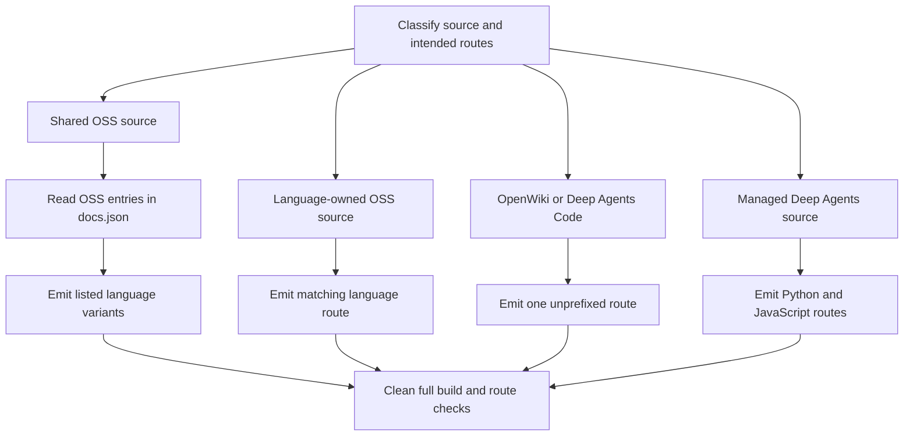

# Changing Versioned and Unversioned Content

A route change has four separate contracts: source ownership, generated artifacts, navigation, and redirects. `src/docs.json` participates in both navigation and—in the case of shared OSS pages—generation eligibility; it does not make an arbitrary source file exist. Edit authored files under `src/`, never `build/`: the builder replaces that directory at the start of every full build.



This flow shows how source family and navigation determine output before Mint validates public routes.

## 1. Select the source family first

The builder accepts `python` and `js` conditional targets; their public URL segments are `python` and `javascript`.

| Source family | Authoring location | Full-build result |
| --- | --- | --- |
| Shared OSS page | Most of `src/oss/` | One or both `/oss/python/...` and `/oss/javascript/...` variants, according to the OSS routes listed in `docs.json` |
| Language-owned OSS page | `src/oss/python/...` or `src/oss/javascript/...` | Only that language's route; the ownership directory is removed |
| Deep Agents Code | `src/oss/deepagents/code/...` | One unprefixed `/oss/deepagents/code/...` route |
| OpenWiki | `src/oss/openwiki/...` | One unprefixed `/oss/openwiki/...` route |
| Managed Deep Agents | Direct `src/langsmith/managed-deep-agents*.mdx` | `/langsmith/python/...` and `/langsmith/javascript/...` |
| Other LangSmith content | `src/langsmith/...` | One unprefixed `/langsmith/...` route rendered with the Python target |

### Shared OSS pages are navigation-aware

For a Markdown shared OSS page, the builder reads all `oss/python/...` and `oss/javascript/...` routes from `src/docs.json`. If the source route is listed in exactly one language menu, it produces only that variant. If it is listed in both menus—or in neither—it produces both. This prevents a page intended for one SDK from becoming an empty or misleading page in the other SDK. A directory entry can represent `index`, unless a language-owned file at that directory itself owns the route.

Consequently, update the corresponding OSS navigation entry before relying on a single-language result, and verify both **presence and absence** after a clean full build. `build_file()` follows this same navigation-aware rule for shared OSS pages, so it is suitable for local iteration; `make build` remains the authoritative clean check because it removes stale output before generating every family.

Language-owned directories are different: during the full OSS passes, the builder skips the other ownership tree and removes `python` or `javascript` from the emitted remainder. Use these directories for genuinely separate documents, not merely to control sidebar placement.

### Unversioned OSS products and Managed Deep Agents

OpenWiki and Deep Agents Code are deliberate single-output OSS exceptions. They use the Python conditional target as a deterministic fallback; this does not make them Python documentation. Their own routes remain unprefixed. A bare ordinary `/oss/...` link authored in one of these pages resolves to the Python OSS route.

Managed Deep Agents is a LangSmith exception in the other direction. The ordinary LangSmith pass excludes Managed Deep Agents files, and a dedicated pass emits both language variants. That dedicated full-build pass discovers direct `.mdx` filenames matching `managed-deep-agents*.mdx`; although individual-file recognition also accepts `.md`, a `.md` file is not discovered by that dedicated glob. Do not create an unversioned duplicate for compatibility: redirects own that concern.

## 2. Author conditional content and symbolic references

Put shared prose outside complete, adjacent `:::python` and `:::js` units. Each branch should contain the entire varying unit—such as an import and example, a filename and command, or a table—so an API, type, or filename never crosses SDK boundaries.

````markdown
Shared explanation.

:::python
```python
from langchain.agents import create_agent
```
:::

:::js
```typescript
import { createAgent } from "langchain";
```
:::
````

For a selected target, preprocessing removes the matching supported fence while retaining its content and removes the other supported block. Only `python` and `js` are valid targets; an unsupported conditional label is retained verbatim. Managed Deep Agents pages use this structure to share product guidance while varying filenames, SDK API names, runtime types, and nullability conventions.

### Conditional fences are a regex transform

Conditional matching is document-wide and regex-based, not code-fence-aware or nested-block-aware. Escape literal fence syntax with a backslash, do not nest conditionals, and do not assume indentation or a fenced code example will protect live markers. The first eligible closing marker can terminate the non-greedy match.

````markdown
\:::python
This is literal documentation syntax.
\:::
````

### Scope `@[references]` to the right SDK

Before conditional rendering, Markdown preprocessing replaces autolinks such as `@[Name]`, `@[title][Name]`, and backticked forms. Outside ordinary code fences, a `:::python` or `:::js` fence selects that autolink map; otherwise the build target supplies the default scope. Missing references are logged and left unchanged by the renderer.

An unfenced reference in a shared OSS page therefore needs to resolve in both scopes. Put SDK-specific references in their matching branch and run:

```bash
make check-cross-refs
```

This source-level check scans Markdown and MDX under `src/`, derives scopes from the path, honors code and conditional fences, and fails when a reference is unresolved. It complements, rather than replaces, generated-route link checks.

## 3. Author variant-aware links and snippets

Use an absolute, unqualified OSS link when the destination should follow the page's build target:

```mdx
<!-- openwiki: broken internal link [/oss/deepagents/overview] file "/oss/deepagents/overview" does not exist. Fix the href or restore the target, then delete this comment. -->
[Deep Agents overview](/oss/deepagents/overview)
```

For a target-language build, the builder inserts `python` or `javascript` after `/oss/`. It preserves routes already qualified with a language, image paths, and OpenWiki and Deep Agents Code roots and descendants. Qualify a route explicitly only when it must intentionally stay on one SDK.

Use the same authoring form for a Managed Deep Agents destination:

```mdx
<!-- openwiki: broken internal link [/langsmith/managed-deep-agents-deploy] file "/langsmith/managed-deep-agents-deploy" does not exist. Fix the href or restore the target, then delete this comment. -->
[Deploy](/langsmith/managed-deep-agents-deploy)
```

The Python and JavaScript variants receive their respective `/langsmith/python/` or `/langsmith/javascript/` route. A route already carrying a language segment remains fixed. In particular, do not change shared Managed Deep Agents links to Python merely because public, unprefixed redirects target Python.

### Reusable Markdown snippets

Put reusable fragments under `src/snippets/` and import an unqualified Markdown fragment from a versioned consumer:

```mdx
import RequiresLanggraphServer from '/snippets/oss/requires-langgraph-server.mdx';
```

The builder rewrites eligible `.md` and `.mdx` imports to `/snippets/python/` or `/snippets/javascript/`. It leaves an already scoped import and JSX or TSX component imports unchanged. It also independently preprocesses Markdown snippets into Python and JavaScript copies plus a Python-targeted default copy. Use absolute `/oss/...` links inside shared snippets: the language-specific copies then work when imported from pages at any nesting depth.

## 4. Deliver navigation and redirects separately

After choosing output routes, update `src/docs.json` with extensionless paths relative to `src`. Navigation determines shared-page language eligibility as well as reader discovery, so it is a build input—not a final cosmetic step.

- Add shared OSS routes to each language menu that should emit them. A language-owned source has only its matching route. Removing the last route from one menu intentionally removes that shared variant on the next clean build.
- Keep Managed Deep Agents' Python and JavaScript tabs structurally paired. The current tabs place Identity in **Agent capabilities** and Custom frontend in **Build and deploy** for both variants; add a shared Managed Deep Agents page at corresponding locations.
- Review every retired public URL. Managed Deep Agents has no unprefixed emitted pages; `docs.json` redirects unprefixed and legacy Managed Deep Agents URLs to Python routes. Redirect old URLs rather than creating an orphaned unversioned page.

For a move, addition, or deletion, explicitly check the source family, every desired route, every forbidden stale sibling, navigation placement, inbound links, and redirect destinations. See [Adding and Maintaining Documentation Pages](/openwiki/operations/adding-pages.md) for the general page lifecycle.

## 5. Clean-build and validate the public contract

Prioritize a clean full build for output and deletion verification. It clears `build/`, generates OSS variants and unversioned OSS products, emits ordinary LangSmith and Managed Deep Agents content, then copies shared files. Never infer deletion from an incremental result.

```bash
make build
make check-cross-refs
make broken-links
```

Inspect generated output without editing it:

1. Each desired variant exists, and routes that should have been removed—such as an unlisted shared sibling or the wrong ownership language—do not exist.
2. Each variant retains shared content and only its own conditional branch, without selected-branch markers.
3. Autolinks, bare OSS links, bare Managed Deep Agents links, and Markdown imports resolve to the expected variant.
4. Explicitly qualified routes, image paths, OpenWiki paths, and Deep Agents Code paths remain unchanged.
5. `docs.json` exposes every intended reader route and redirects each retired URL to a route that exists in this clean build.

`make broken-links` runs the build first and asks Mint to check links and redirects. It filters standalone snippet reports because snippets contain absolute language-prefixed OSS links that are valid when inlined. When headings or fragments changed, use `make broken-links-with-anchors`; it checks anchors as well as redirects.

When altering builder behavior, add a focused regression in `tests/unit_tests/test_builder.py`. Cover both content and route presence/absence for the relevant family—especially the `docs.json`-controlled single-language shared-page case—and cover both targets for conditional or link-rewrite changes.

## Completion checklist

- [ ] Classify the source before choosing a sidebar or redirect.
- [ ] For a shared OSS page, add or remove its Python and JavaScript `docs.json` routes intentionally.
- [ ] Keep common prose outside complete `:::python` and `:::js` units; do not nest fences.
- [ ] Place SDK-only autolinks in the relevant conditional branch and run `make check-cross-refs`.
- [ ] Use bare `/oss/...` and Managed Deep Agents routes only when the link should follow the active variant.
- [ ] Import Markdown snippets without a language prefix and use absolute OSS links inside shared snippets.
- [ ] Keep Managed Deep Agents tab placement paired and redirect retired unprefixed public routes.
- [ ] Run `make build`, inspect required and deleted artifacts, then run documented Mint link checks.

## See also

- [Build System](/openwiki/architecture/build-system.md)
- [Preprocessing](/openwiki/concepts/preprocessing.md)
- [Versioning](/openwiki/concepts/versioning.md)
- [Adding and Maintaining Documentation Pages](/openwiki/operations/adding-pages.md)
- [Builder Tests](/openwiki/testing/builder-tests.md)
